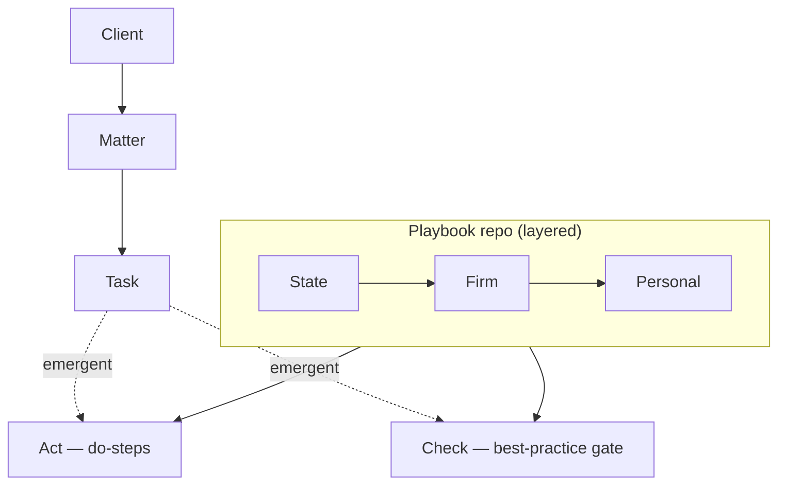
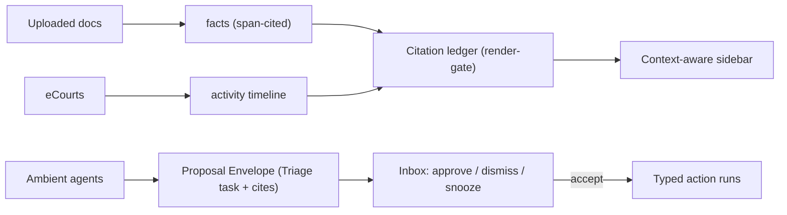

# Legal Owl — Agent Army & Grounding Layer

## Summary

Add an agent-native grounding layer to Legal Owl: a fleet of specialized, approve-before-act AI agents that read and write the case record through one citation ledger, fronted by an always-present, context-aware right-sidebar assistant. Grounding is real-data-first (relational timeline + span-cited facts); best practices are layered (State → Firm → Personal); legal-consequential dates are computed by rules, never generated. Phase 1 ships the wedge: dump a case file, and minutes later the matter answers questions with pin-cites.

## Problem Frame

A solo litigator runs dozens of active matters across eCourts portals, spreadsheets, and email, acting as a data-entry clerk instead of a lawyer. Generic LLM tools produce plausible text no careful lawyer will act on — wrong on a limitation date or an invented party name is a liability, not a help. And the wall in front of every case-management tool is manual entry: nobody hand-types 80 running matters, so the record never gets populated and no automation has anywhere to land. The differentiator is grounding — answers traceable to real case data and to jurisdiction rules — and the way past the wall is to make onboarding a matter the moment the product proves itself.

## Key Decisions

- **Hybrid interaction, sidebar as the spine.** An always-present, context-aware right sidebar (it knows the current route, matter, task, and selection) is the primary surface, complemented by ambient agents that feed the Inbox and on-demand specialist actions. The sidebar dispatches to specialists; it holds no mandate of its own.
- **Approve-before-act.** Agents propose; the lawyer approves every write and every outbound. Reversible-internal actions (e.g., acknowledging a conflict flag) may use a lighter touch.
- **Citation ledger is the spine, enforced by a render-gate.** Every agent claim links to source refs; unlinkable sentences are dropped in the renderer, not asked-for in the prompt. This is the single most differentiating investment.
- **Tiered citation grain.** Structured facts (dates, statuses, parties, eCourts fields) cite record-level; documents, orders, and rulesets cite span-level (document + start/end offset).
- **Substrate now: relational timeline + a span-cited `facts` store. Knowledge graph later.** Intake extraction writes typed facts (with provenance) into the relational model. A knowledge graph with Cypher-style queries is a Phase-4 projection of verified facts, not a new source of truth.
- **The ladder deepens: Client → Matter → Task → Act → Check.** Acts are do-steps; Checks are best-practice QA gates. Both are additive and emergent — they appear when a task warrants them, so the task-first simplicity survives.
- **Layered Playbook repo: State → Firm → Personal.** One repo supplies default Acts/Checks, checklists, templates, and rulesets, with Personal overriding Firm overriding State. Similar-case guidance surfaces reusable patterns and templates, never another client's privileged facts.
- **Deterministic legal-date engine.** Limitation and filing dates are computed by a rule engine over verified facts (Limitation Act 1963 and procedural codes); the LLM maps facts to rule inputs and explains, but never computes the date.
- **CNR is the hard isolation boundary, enforced at ingest and query.** One matter's content must never surface for another — the worst failure mode.
- **The enabling primitive is a typed-action layer.** Every mutation is defined once (schema + `run`) as UI action, HTTP endpoint, and agent tool. An agent proposal is a serialized typed action awaiting the lawyer's signature — which lets the shipped Inbox become the universal approval surface.
- **The wedge is intake.** Phase 1 builds the Intake Registrar + Ask-the-File sidebar + one tracer limitation rule — the dependency root every other agent runs on, and the demo that dissolves the adoption wall.

## Actors

- A1. Lawyer (solo / small firm) — the human-in-the-loop; sole authority for writes and outbound.
- A2. Agent fleet — specialized proposers (see The Agent Fleet).
- A3. eCourts partner API — source of synced court facts (already integrated).
- A4. Case documents / uploads — source of span-cited facts.
- A5. Resend — the outbound client-email channel (already integrated).

## The Agent Fleet

Ambient agents emit proposals; on-demand and sidebar agents respond to the lawyer. All ground on the citation ledger.

| Agent | Mandate | Trigger | Reads | Proposes |
|---|---|---|---|---|
| Intake Registrar | Turn a docs-dump into verified, citeable facts | Ambient — on upload / matter creation | Uploaded PDFs, CNR, eCourts projections | Span-cited facts, seeded timeline, party updates, candidate deadlines |
| Court Scout | Interpret the eCourts sync into meaning | Ambient — nightly / on sync | Cause lists, sync diff, prior hearing purposes | Interpreted Inbox items, order-PDF routing, defect-memo detection |
| Limitation Clerk | Front the deterministic date engine | Ambient — on any date-bearing fact | Verified facts, ruleset repo | `deadline` tasks with full computation trace |
| Hearing-Prep Junior | The evening-before cited one-pager | Scheduled + sidebar-invoked | Last order spans, open tasks, cause-list purpose | Pin-cited brief + carry-list checklist |
| Outcome Scribe | Two spoken lines → the whole fan-out | Sidebar-invoked on hearing days | Dictation + hearing task + facts | Remark, next-date, dated tasks, queued client draft |
| Client Herald | Plain-language / vernacular client updates | Ambient-draft after outcome / order | Verified activity + facts (court ranks above notes) | Per-sentence-cited outbound email (hard send gate) |
| Drafting Junior | Procedural first drafts, slot-filled from cites | On-demand / sidebar | Template repo, matter facts, Limitation traces | Draft with cited slots; `[NOT ON RECORD]` gaps |
| Conflict Sentinel | Entity-resolution upgrade of the conflict check | Ambient — on new client / matter / party-fact | Parties, clients, party facts across matters | `conflict_flags` with the evidence chain |
| Research Associate (Phase 4) | Record-first research, then law | Sidebar | Matter facts first (CNR-isolated), then ruleset, then graph | Tiered-cited answers; abstains otherwise |

## Requirements

**Grounding & citations**

- R1. Every agent-surfaced claim links to source refs; unlinkable sentences do not render (gate in the renderer, not the prompt).
- R2. Citations are tiered: structured facts cite record-level; documents, orders, and rulesets cite span-level (document + start/end offset).
- R3. A `facts` store holds extracted, typed, citeable facts, each carrying span provenance, a confidence, and a verified/proposed status.
- R4. Legal-consequential dates are computed by a deterministic rule engine over verified facts; the LLM maps facts to rule inputs and explains, never computes the date.
- R5. Each computed deadline carries a human-readable computation trace (rule, cited inputs, exclusions, rule-pack version).

**Case model — the deepened ladder**

- R6. The ladder extends Client → Matter → Task → Act → Check; Acts (do-steps) and Checks (best-practice QA gates) attach under a Task.
- R7. Acts and Checks are additive and emergent — a plain task needs neither; they appear only when a task warrants them.
- R8. Acts and Checks accept agent proposals and modifications under lawyer approval.

**The Playbook layer**

- R9. A layered repo supplies default Acts, Checks, checklists, and templates: State → Firm → Personal, with Personal overriding Firm overriding State.
- R10. The repo holds both a deterministic ruleset (limitation / procedural, feeding the engine) and a citeable reference corpus (statutes, court rules, drafts, feeding grounding).
- R11. A similar-cases layer surfaces reusable patterns, checklists, and templates across the lawyer's or firm's matters — never another client's privileged facts.

**Agent platform**

- R12. Every mutation is defined once as a typed action (schema + `run`), serving as UI action, HTTP endpoint, and agent tool.
- R13. An ambient agent's output is a Proposal Envelope — a Triage-state task carrying a typed-action proposal, its citations, and its trace; the existing Inbox is the universal approve / dismiss / snooze surface.
- R14. The always-present right sidebar is context-aware (route, matter, task, selection), answers only via the citation ledger, and dispatches to specialists rather than acting as one.
- R15. The sidebar's conversation persists on the shipped `conversations` / `messages` substrate, one context per matter.

**Autonomy & safety**

- R16. Approve-before-act: the lawyer approves every write and every outbound (client email, filing); reversible-internal actions may use a lighter touch.
- R17. CNR is the hard retrieval-isolation boundary, enforced at ingest (quarantine mismatched docs) and at query (matter-scoped retrieval).
- R18. Abstention by default: when the record can't support an answer, the assistant says so ("not on the record before me") and offers to complete the record.
- R19. Official court documents rank above lawyer notes when facts conflict or when grounding a claim.

## Key Flows

- F1. Matter-init ingestion (the wedge)
  - **Trigger:** Documents uploaded to a matter, or a matter is created.
  - **Steps:** Upload to the private bucket → classify each doc → CNR guard (quarantine if the case number on the doc mismatches) → extract typed facts with span provenance (below-threshold extractions abstain, not propose) → reconcile / dedupe with source-rank → rule pass proposes the tracer deadline with its trace.
  - **Outcome:** Verified facts seed the timeline and `matters.parties`; the Ask-the-File sidebar answers questions with pin-cites; unverifiable pages appear in an abstention panel.
  - **Covered by:** R1, R2, R3, R4, R17, R18, R19.

- F2. Ambient proposal → approval
  - **Trigger:** An agent detects an event (order synced, date-bearing fact, possible conflict).
  - **Steps:** Agent emits a Proposal Envelope (Triage task + citations + trace) → lawyer accepts (runs the typed action), edits, dismisses, or snoozes.
  - **Outcome:** The change lands with provenance, or is cancelled — never silently applied.
  - **Covered by:** R12, R13, R16.

- F3. Outcome capture fan-out (Phase 2)
  - **Trigger:** Lawyer dictates two lines from the Outcome Scribe after a hearing.
  - **Steps:** Scribe proposes an immutable remark, a next-hearing-date update, new dated tasks (statutory ones routed through the Limitation Clerk), and a queued client draft, shown on one review card.
  - **Outcome:** Approve-all or per-item; the diary updates itself.
  - **Covered by:** R4, R13, R16.

## Acceptance Examples

- AE1. **Covers R1.** Given a drafted answer with one uncited sentence, when it renders, then the uncited sentence is dropped before the lawyer sees it.
- AE2. **Covers R17.** Given an uploaded PDF whose cause-title case number differs from the matter's CNR, when ingested, then its facts are quarantined and never enter the matter's pool until confirmed.
- AE3. **Covers R4, R5.** Given a decree date and certified-copy dates, when a limitation deadline is proposed, then the date comes from the rule engine with a trace, and no LLM-generated date is shown.
- AE4. **Covers R18.** Given a question whose answer isn't in the record, when asked in the sidebar, then it responds "not on the record before me" and offers to upload or enter the source.
- AE5. **Covers R11.** Given the lawyer opens a task, when similar-case guidance appears, then it shows anonymized checklists and templates, not another client's facts.

## Success Criteria

- A 200-page case file is verified into citeable facts in about ten minutes, because verification is reading snippets, not documents.
- No uncited claim renders anywhere in the assistant surface.
- Legal-consequential dates are never LLM-generated; each carries a rule trace.
- Abstention is measured and visible, and drives record completion rather than hiding.
- Per-extractor precision is tracked per lawyer; bulk-accept is gated on a precision bar.

## Phased Roadmap

- Phase 1 — The Record (the wedge): `facts` store, citation render-gate, Verification Bench, Ask-the-File sidebar (on `conversations` / `messages`), typed-action layer v0 (migrate two or three existing Server Actions to prove the pattern), and a rule-engine skeleton with one tracer rule family (appeal limitation: Art. 116 + s.12(2) certified-copy exclusion + s.4 holiday rollover).
- Phase 2 — The Day: Court Scout, Hearing-Prep Junior, Outcome Scribe; full Limitation Clerk + layered ruleset repo v1.
- Phase 3 — The Voice & Pen: Client Herald (per-sentence-cited, vernacular), Drafting Junior + template repo, Conflict Sentinel v2 (entity resolution).
- Phase 4 — The Graph: knowledge graph + Cypher-style queries as a projection of verified facts; powers Research Associate cross-matter queries and bench analytics.

## Scope Boundaries

**Deferred for later**

- Knowledge graph + Cypher-style queries (Phase 4 only; a projection of verified facts, not a source of truth).
- Autonomous send or filing — always approve-before-act within these phases.
- The full agent roster beyond the wedge (Phases 2–3).
- RAG over arbitrary documents beyond span-cited fact extraction.

**Outside this product's identity** (per `STRATEGY.md`)

- Associate coordination / team task-management.
- Invoice or billing generation.
- Enterprise law-firm targeting.

## Dependencies / Assumptions

- Commits the AI SDK + AI Gateway runtime, currently deferred in `docs/ARCHITECTURE.md`.
- The agent-native typed-action layer must precede the fleet — today's Server Actions are plain `FormData` functions with no schema layer.
- Requires a net-new document ingestion / OCR capability that can capture span offsets.
- Builds on the shipped `conversations` / `messages` substrate (no UI yet), the eCourts sync, and the `tasks` / `activity` model.
- Assumes span provenance can be captured for uploaded PDFs; the exact offset representation is a planning decision.

## Outstanding Questions

**Resolve before planning**

- Confirm the Phase-1 tracer rule family (proposed: appeal limitation from a decree/judgment date).

**Deferred to planning**

- Exact `facts` schema, and how Act / Check render in the task UI.
- Extractor / OCR technology and how span offsets are stored (character offsets vs page coordinates).
- Whether ingestion events extend the `activity_kind` enum or reuse `court_event` with a `source='ingestion'` discriminator.
- Retrieval mechanism for span-level citations (embeddings vs structured lookup).
- Model-tier assignment per agent.

## Sources / Research

- `docs/ARCHITECTURE.md` — §3 (agent-native typed-action layer), §7 (citation ledger, abstention, deterministic deadline math, approve-before-act), §11 (deferred RAG / autonomous send), §13 step 7 (AI on top of the timeline).
- `docs/research/ai-native-legal-office.md` — define-once agent-native actions; "the single most differentiating engineering investment is the citation ledger"; retrieval-bounded generation.
- `docs/research/architecture-ideas-from-legal-systems.md` — CNR as the hard isolation boundary; `Document.source` ranking; "the future RAG context is the case timeline, not just PDFs".
- `supabase/migrations/20260624000001_task_first_model.sql` — `tasks` / `activity` / `taggings` and the `conversations` + `messages` substrate.
- `apps/web/lib/ecourts/sync.ts` — `content_hash` idempotency; new changes raised as Triage-state Inbox tasks.
- `STRATEGY.md` — the grounding bet and the standing out-of-scope list.

---
