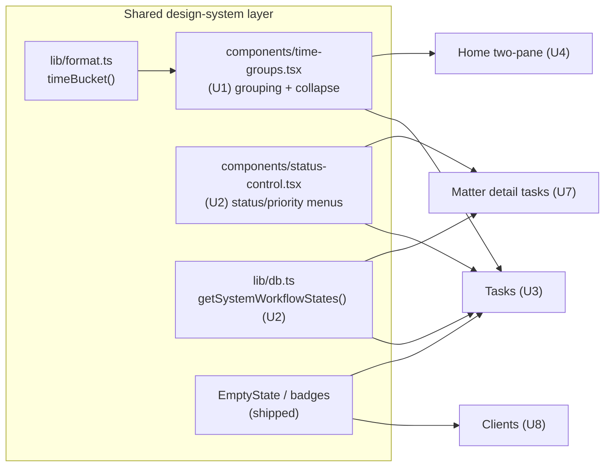

> **Implemented 2026-06-22** (U1–U10), `npm run build` green. Two runtime prerequisites before
> these work against the live DB / in production:
> 1. Apply the new migration: `supabase db push` for `supabase/migrations/20260622000001_profiles.sql`
>    (Settings profile read/write needs the `profiles` table).
> 2. Add `${SITE_URL}/auth/callback` to the Supabase Auth redirect allowlist so password recovery
>    links resolve (U10).

# feat: Product-experience upgrade — natural office flow

Continue the Mobbin-driven UX upgrade so the app reads like a lawyer's natural office flow: surface
what must be acted on first, grouped the way a lawyer thinks about the day, with consistent
design-system primitives. This plan finishes the benchmark's **"Now" bucket** on the surfaces not yet
touched and lands two **shared "Next" foundations** (the time-horizon grouping component + the two-pane
Home reframe). The AI-grounding surface is explicitly deferred to a separate plan.

**Target repo:** this repo. All paths are relative to `apps/web/` unless noted (migrations live at the
repo-root `supabase/migrations/`). **Origin:** `docs/design/benchmarks/README.md` (the Now/Next/Later
roadmap; item IDs N#/X# below trace to it).

---

## Already shipped (do not re-implement)

This plan builds on a foundation already merged in the working tree. **Do not redo these:**

- Escalated urgency in `components/badges.tsx` — `DueDateBadge`/`HearingPill` now have overdue→today→this-week→later tiers; `MatterStatusBadge` added (N2).
- `lib/format.ts` — `timeBucket()`, `isThisWeek()`, `TIME_BUCKET_LABELS/ORDER` added.
- `lib/nav.ts` — single source of truth, grouped "Today"/"Case files"; consumed by sidebar, command palette, header.
- `components/page-header.tsx` — `EmptyState` redesigned on the `empty` primitive (icon, description, `no-results` variant).
- `components/command-palette.tsx` — Recent group + footer legend.
- `components/app-sidebar.tsx` — grouped nav, live counts (inbox/tasksDueToday/hearingsToday), Settings in footer.
- `components/app-header.tsx` — duplicate title removed, breadcrumb on sub-pages.
- `app/globals.css` — border bumped, dark-tuned shadow ramp.
- Calendar overdue fix (N1), Home due-today (N3), Matters rows + tab counts (N4), layout count wiring.

---

## Requirements & traceability

Each unit advances one or more origin roadmap items (`docs/design/benchmarks/README.md`):

| Origin ID | Theme | Unit |
|---|---|---|
| X1 | Shared time-horizon grouping (Overdue/Today/This week/Later) | U1, U3, U4 |
| N5 | Tasks: counts, status/priority pills, quick-create, grouping | U2, U3 |
| X2 | Home: two-pane "Today" reframe | U4 |
| N6 | Inbox: snooze menu + undo toasts | U5 |
| N9 | Settings: editable Profile/Firm + save model | U6 |
| N10 | Matter detail quick wins (id/CNR copy, upload→timeline, confirm delete) | U7 |
| N12 | Clients: render captured fields, search email/phone, counts, positive conflict artifact | U8 |
| N7 | Landing: fix dead CTA, social proof, residency badge | U9 |
| N8 | Auth: password recovery + honest "Request access" | U10 |

**Success criteria:** every list surface groups/colours obligations consistently; Tasks is creatable
and scannable; Inbox snooze is user-controlled and reversible; Settings is writable; matter id/CNR are
copyable and uploads appear on the timeline; clients show all captured fields and a positive conflict
artifact; landing/auth close the trust + recovery gaps. Correctness gate after every unit:
`npm run build` (tsc + route gen) stays green.

---

## Testing reality (read before the per-unit scenarios)

The repo has **no test runner** (`CLAUDE.md`: "no test suite yet; `npm run build` is the correctness
gate"). Test scenarios below are therefore written as **behavioural verification scenarios** — the
implementer verifies them by build + manual run unless a harness is introduced. Two units add
genuinely pure, unit-testable logic (U1 bucketing, U8 search predicate); for those, the scenarios are
written so they map 1:1 onto real unit tests **if** a runner (e.g. Vitest) is added later. Introducing
a test harness is out of scope for this plan; do not block units on its absence.

---

## High-Level Technical Design

The spine is "shared primitives → surfaces": fix a behaviour once in a shared primitive and every
consuming surface inherits it. This plan adds two new shared primitives (grouping component, status
control) on top of the already-shipped badge/nav/empty primitives.

Independent surfaces (no shared-primitive dependency): Inbox (U5), Settings + new `profiles` table
(U6), Landing (U9), Auth recovery (U10).

---

## Key Technical Decisions

- **KTD1 — One shared grouping component, not per-surface grouping.** `components/time-groups.tsx`
  owns Overdue/Today/This week/Later, counts, collapse, and overdue-first ordering, consuming
  `timeBucket()`. Tasks and Home both render through it so grouping never drifts. _Rationale:_ the
  single most-repeated benchmark recommendation; consistency is the point.
- **KTD2 — Replace native `<select>` with a `DropdownMenu` + `StatusBadge`/`PriorityBadge` control,
  not shadcn `Select`.** The control must *show* the shape+colour badge in both trigger and options;
  a plain Select can't. _Rationale:_ the project's StatusBadge is the design-system asset to surface.
- **KTD3 — New `profiles` table keyed on `auth.uid()` with RLS for Settings**, not user metadata or
  reusing `waitlist`. _Rationale:_ profile fields (lawyer name, firm, etc.) power client-update emails
  and the future client portal; they belong in an RLS-guarded app table like every other entity
  (`auth.uid() = lawyer_id` convention).
- **KTD4 — Inbox undo = revert state to `pending`, surfaced via a `sonner` action toast**, not
  soft-delete. Snooze/dismiss already set a state column; undo just writes it back. _Rationale:_
  reuses existing state machine; cheapest reversible model.
- **KTD5 — Keep the Server-Action form pattern; use the `field` primitive for layout, not
  react-hook-form.** _Rationale:_ matches every existing write path; `form` was deliberately not
  installed.
- **KTD6 — Conflict check stays advisory; only the *positive* artifact ("No conflicts found ✓") is
  added now.** The full in-flow gated step with acknowledgement audit (origin X5) is deferred.
  _Rationale:_ scope — X5 is a "Next" structural item not selected for this plan.
- **KTD7 — Extract `getSystemWorkflowStates(supabase)` into `lib/db.ts`** and reuse it in Tasks and
  matter detail instead of the duplicated inline query. _Rationale:_ removes a known duplication the
  recon flagged; keeps the status control fed from one place.

---

## Implementation Units

Grouped into four phases by dependency. Phase A primitives unblock Phase B.

### Phase A — Shared primitives

### U1. Time-horizon grouping component
**Goal:** A reusable component that groups dated items into Overdue / Today / This week / Later, with
per-group counts, overdue-first ordering, and collapse (overdue never collapsed).
**Requirements:** X1.
**Dependencies:** none (uses shipped `lib/format.ts`).
**Files:** `components/time-groups.tsx` (new); `components/collapsible-section.tsx` (new, small client
collapse wrapper on the `collapsible` primitive) — or inline the client wrapper in the same file.
**Approach:** Export a pure helper `groupByTimeHorizon<T>(items, getDate)` returning
`{ bucket, label, items }[]` in `TIME_BUCKET_ORDER`, omitting empty buckets and items with no date
(caller decides where undated go). Export a presentational server component `<TimeGroups>` that takes
the grouped result + a `renderRow` callback and renders each section header (`label` + tnum count)
with rows; wrap each non-overdue section body in a client `CollapsibleSection` (defaultOpen). Overdue
header uses `text-urgent`; section list border mirrors the calendar's `border-urgent/40` for overdue.
**Patterns to follow:** the just-shipped calendar Overdue/section markup in
`app/(app)/calendar/page.tsx`; `EmptyState` composition style; `collapsible` primitive in
`components/ui/collapsible.tsx`.
**Test scenarios (pure helper — unit-testable if a runner is added):**
- Covers X1. Given items dated yesterday/today/+3d/+30d and one undated → groups into overdue, today,
  week, later in that order; undated excluded.
- Empty input → returns `[]`; surface renders nothing (caller shows EmptyState).
- All items in one bucket → only that bucket returned; other headers absent.
- Counts equal item length per bucket; ordering within a bucket preserves input order (caller pre-sorts).
- Boundary: due in exactly 7 days → `week`; in 8 days → `later`; due today → `today`, not `week`.
**Verification:** `npm run build` green; helper used by U3/U4 renders the four labelled groups with
correct counts on a seeded account.

### U2. Workflow-state helper + design-system status/priority control
**Goal:** Remove the duplicated workflow-state query and replace the native `<select>` task controls
with badge-bearing menus.
**Requirements:** N5 (partial), KTD7.
**Dependencies:** none.
**Files:** `lib/db.ts` (add `getSystemWorkflowStates`); `components/status-control.tsx` (new client
component exporting `TaskStatusMenu` and `TaskPriorityMenu`); update callers in `components/tasks-list.tsx`
and `components/matter/task-list.tsx` (consume the new control — the matter task list is touched here
so both task surfaces share one control).
**Approach:** `getSystemWorkflowStates(supabase)` returns the system states (`lawyer_id is null`,
ordered by position) typed as `WorkflowState[]`. `TaskStatusMenu` renders a `DropdownMenu` whose
trigger is the current `StatusBadge` and whose items are the states (each an option `StatusBadge`),
calling the existing `updateTaskState(taskId, stateId)` via `useTransition`. `TaskPriorityMenu` mirrors
this for `PRIORITIES` using `PriorityBadge` (+ a neutral glyph for `none`). Keep the existing action
imports from `app/(app)/matters/[id]/actions.ts`.
**Patterns to follow:** existing client-island + `useTransition` pattern in `components/tasks-list.tsx`;
`DropdownMenu` usage in `components/app-header.tsx`; Base UI `type="button"` rule (set explicitly).
**Test scenarios:**
- Covers N5. Selecting a status option calls `updateTaskState` with that `stateId`; trigger badge
  updates after the transition.
- Selecting a priority calls `updateTaskPriority`; `none` renders a neutral trigger, not an empty box.
- Disabled/pending state during `useTransition` prevents double-submit.
- Keyboard: menu opens on Enter/Space, options navigable (Base UI default) — smoke check.
**Verification:** Tasks page and matter Tasks tab show identical badge menus; no native `<select>`
remains in either; `npm run build` green.

---

### Phase B — Flow surfaces

### U3. Tasks surface upgrade
**Goal:** Make Tasks creatable, scannable, and grouped by time-horizon.
**Requirements:** N5, X1.
**Dependencies:** U1, U2.
**Files:** `app/(app)/tasks/page.tsx`; `components/tasks-list.tsx`; `app/(app)/tasks/actions.ts` (new —
a `createQuickTask(formData)` wrapper, or re-export/move task create so Tasks doesn't import from the
matter route).
**Approach:** Add counts to each filter chip (compute from the fetched set; keep current client-side
filter but tally per filter). For the default "Open" view, render tasks through `<TimeGroups>` (U1)
bucketed on `due_date` (undated → a trailing "No date" group). Swap the two native selects for U2's
`TaskStatusMenu`/`TaskPriorityMenu`. Add a top quick-create composer: title input + optional matter
(`combobox`, fed by matters list) + due (`calendar`/date input) + priority; submit to
`createQuickTask`. A task created without a matter is disallowed by the schema (actions require
`matter_id`) — so the matter picker is required; document this in the composer copy.
**Patterns to follow:** matter `createTask` in `app/(app)/matters/[id]/actions.ts` for the insert
shape (key via `nextKey`, default `To-Do` state); `combobox` usage; `EmptyState` for the empty view.
**Test scenarios:**
- Covers N5. Open view groups tasks under Overdue/Today/This week/Later with counts; completing the
  last overdue task removes the Overdue group on revalidate.
- Filter chips show correct counts; switching filter preserves them.
- Quick-create with title+matter+due+priority inserts an `actions` row with a generated key and
  `To-Do` state; it then appears in the correct time-group.
- Quick-create without a matter is blocked with inline copy (not a 500).
- Status/priority menus mutate via U2 and reflect after transition.
**Verification:** create a task from `/tasks` end-to-end; grouped view + counts correct; build green.

### U4. Home two-pane "Today" reframe
**Goal:** Reframe Home as a command center: greeting, quick actions, agenda on one side and grouped
work on the other; widen from the narrow column.
**Requirements:** X2, X1.
**Dependencies:** U1.
**Files:** `app/(app)/home/page.tsx`.
**Approach:** Widen container (`max-w-5xl`/`6xl`) and split into a two-column grid at `lg` (single
column on mobile). Left: greeting (`Good morning` + `fmtDateLong`), next hearings, upcoming deadlines.
Right: a quick-action row (New matter / Add task / Open inbox), the inbox "what needs review" banner
(kept), and tasks rendered through `<TimeGroups>` (overdue + due-today already queried; add a
this-week task query to fill the group). Keep the positive "You're clear today" state when no
overdue/today tasks. Preserve the `Onboarding` empty-account branch unchanged.
**Patterns to follow:** existing Home queries/sections (already partly upgraded); `<TimeGroups>` from
U1; quick-action buttons mirror the header "New" dropdown destinations.
**Test scenarios:**
- Covers X2. At `lg`, agenda and work render side by side; at `sm`, they stack; no horizontal overflow.
- Tasks appear under the correct time-groups; "You're clear today" shows only when overdue+today empty.
- Quick-action buttons route to `/matters/new`, the task composer, and `/inbox`.
- Empty account still short-circuits to `Onboarding` (sample-data CTA intact).
**Verification:** Home on a seeded account shows the two-pane layout with grouped work; build green.

### U5. Inbox triage — snooze menu + undo
**Goal:** Give snooze a user-chosen duration and make dismiss/snooze reversible.
**Requirements:** N6.
**Dependencies:** none (sonner already wired in the app shell).
**Files:** `components/inbox/triage-row.tsx`; `app/(app)/inbox/actions.ts`.
**Approach:** Replace the single snooze button with a `DropdownMenu`: "Until day before next hearing"
(current default, shown only when a next hearing exists), "Tomorrow", "Next week", "Custom…" (date
picker). `snoozeTriageItem` takes an explicit ISO date (keep the hearing-aware default as a computed
option, not the only path). Add `reopenTriageItem(itemId)` that sets state back to `pending` and clears
`snoozed_until`. On dismiss/snooze, fire a `sonner` toast with an **Undo** action calling
`reopenTriageItem`. Add an empty-state via `EmptyState` (icon) for a clear inbox.
**Patterns to follow:** existing `acceptTriageItem`/`snoozeTriageItem`/`dismissTriageItem` in
`app/(app)/inbox/actions.ts`; `DropdownMenu`; `sonner` toast (first usage — establish the
toast-with-action convention here).
**Test scenarios:**
- Covers N6. Snooze→"Tomorrow" sets `snoozed_until` to tomorrow; item leaves the pending list; nav
  count decrements.
- Dismiss shows an Undo toast; Undo calls `reopenTriageItem`, item returns to pending, count restores.
- "Until day before next hearing" option hidden when the matter has no next hearing.
- Custom date in the past is rejected (or clamped) — not silently accepted.
- Accept-as-task flow unchanged (still creates the `actions` row).
**Verification:** snooze a real item with a chosen duration and undo a dismiss; build green.

---

### Phase C — Write-path & safety

### U6. Settings write-path + `profiles` schema
**Goal:** Make Settings editable (lawyer + firm identity) with a save/toast model; reframe data
residency as a trust card.
**Requirements:** N9.
**Dependencies:** none (but unblocks future client-email personalization).
**Files:** `supabase/migrations/20260622000001_profiles.sql` (new, repo-root); `lib/auth.ts` (add a
`getProfile(supabase)` read helper); `app/(app)/settings/page.tsx`; `app/(app)/settings/actions.ts`
(new — `updateProfile(formData)`); a small client `SaveProfileForm` island for the toast, or a
`useFormStatus` submit + post-redirect toast.
**Approach:** Migration creates `profiles (id uuid pk references auth.users, full_name text, firm_name
text, phone text, bar_enrolment text, created_at, updated_at)` with RLS `auth.uid() = id` for
select/insert/update, and an `upsert`-friendly shape. `updateProfile` upserts the row for
`auth.uid()`. Settings renders editable fields via the `field` primitive (Server-Action form, KTD5),
each with helper copy where it matters ("appears on client update emails"). Replace the hardcoded data
residency line with a proper trust card (icon + "Your data stays in India · Mumbai (ap-south-1)").
Keep the demo toggle and sign-out.
**Execution note:** apply the migration with `supabase db push --db-url "$DBURL"` (session pooler;
URL-encode the password per `CLAUDE.md`) — do not hand-edit remote schema.
**Patterns to follow:** RLS policy style in `supabase/migrations/20260621000005_clients_documents.sql`;
`field` primitive; existing Server-Action form posts (e.g. `addRemark`).
**Test scenarios:**
- Covers N9. Saving Profile upserts the `profiles` row; reload shows persisted values; a save toast
  fires.
- RLS: a second lawyer cannot read or update another's profile row (verify policy with two UIDs).
- Empty optional fields persist as null/empty without error; required field (full_name?) validated.
- Data-residency renders as a trust card, not a bare row.
- Demo toggle + sign-out still work.
**Verification:** migration applies cleanly; edit + persist a profile; `npm run build` green.

### U7. Matter detail quick wins
**Goal:** Surface + copy the internal matter id and CNR, link document uploads into the timeline, and
confirm destructive document delete.
**Requirements:** N10.
**Dependencies:** none.
**Files:** `app/(app)/matters/[id]/page.tsx`; `app/(app)/matters/[id]/actions.ts`;
`components/matter/copy-chip.tsx` (new client copy button); a confirm wrapper for delete (client island
on `alert-dialog`), e.g. `components/matter/confirm-delete.tsx`.
**Approach:** Render `matter.key` (mono, `M-…`/`ACT-` style) and the existing `CNRChip` near the title,
each with a `CopyChip` (writes to clipboard, toasts "Copied"). In `uploadDocument` and `deleteDocument`,
also insert a `court_events` row (`source_type: "system"`, an `event_type` like `document_added` /
`document_removed`, `new_value: <file name>`) so the timeline reflects document activity; extend the
in-page `EVENT_LABELS` map. Wrap the delete trash button in an `AlertDialog` ("Delete this document?
This can't be undone") that submits the existing `deleteDocument` form on confirm.
**Patterns to follow:** `CNRChip` in `components/badges.tsx`; the timeline merge + `EVENT_LABELS` in
`app/(app)/matters/[id]/page.tsx`; `court_events` insert shape from the migration; `alert-dialog`
primitive; sonner for the copy toast.
**Test scenarios:**
- Covers N10. Title area shows `key` + CNR; clicking copy writes the value and toasts.
- Uploading a document inserts a `court_events` row; the timeline shows a "Document added" entry at the
  top after revalidate.
- Deleting a document opens an AlertDialog; confirm removes storage object + row + writes a
  "Document removed" timeline entry; cancel does nothing.
- A matter with no CNR shows the key copy only (no broken empty CNR chip).
**Verification:** upload + delete a doc and see both on the timeline; copy works; build green.

---

### Phase D — Clients & public surfaces

### U8. Clients surface upgrade
**Goal:** Show all captured client fields, search email/phone, add counts + status chips, and a
positive conflict artifact.
**Requirements:** N12.
**Dependencies:** none (EmptyState/badges shipped).
**Files:** `app/(app)/clients/page.tsx`; `app/(app)/clients/[id]/page.tsx`.
**Approach:** List — broaden the search predicate from `ilike(display_name)` to an `or(...)` across
`display_name,email,phone`; add a "N clients" count in the header and a calm status chip per row
(reuse the dot+label style of `MatterStatusBadge`, or add a `ClientStatusBadge` using
`CLIENT_STATUS_LABELS`). Detail — render the already-fetched `address`, `gstin`, `pan`, and `type`
(individual/organisation) in the header/details block; for orgs show GSTIN/PAN, for individuals omit
org-only fields. Add a positive conflict artifact: when intake/detail has zero `conflict_flags`, show a
green "No conflicts found ✓" line (the negative banner already exists). Use the `no-results` EmptyState
variant when search returns nothing.
**Patterns to follow:** `MatterStatusBadge` for the chip; matters list `or(...)` search in
`app/(app)/matters/page.tsx`; existing conflict banner in `app/(app)/clients/[id]/page.tsx`;
`CLIENT_STATUS_LABELS` / `ClientType` in `lib/types.ts`.
**Test scenarios (search predicate unit-testable if a runner is added):**
- Covers N12. Searching a substring of an email or phone returns the matching client; name search
  still works.
- Detail renders address/gstin/pan for an organisation; an individual omits GSTIN/PAN cleanly.
- List header shows the correct client count; each row shows a status chip.
- A client with no conflict flags shows "No conflicts found ✓"; one with flags still shows the banner.
- Empty search → `no-results` EmptyState with a clear-search action.
**Verification:** search by email + view an org client's full details; build green.

### U9. Landing trust & CTA fix
**Goal:** Fix the dead final CTA, add social proof, and make data-residency a visible trust badge.
**Requirements:** N7.
**Dependencies:** none.
**Files:** `app/page.tsx`.
**Approach:** Give the hero waitlist form an `id` (e.g. `id="waitlist"`) and point the final CTA at
`#waitlist` (replacing the dead `#top`), or convert the final CTA to an inline duplicate of the
waitlist form. Add a small visible data-residency badge under the hero (icon + "Your data stays in
India"). Add lightweight social proof: a waitlist count ("N lawyers on the waitlist", read from the
`waitlist` table count) and/or a placeholder lawyer-quote band with court attribution — use real data
only (count) and clearly-placeholder copy for any quote, or omit the quote until a real one exists.
**Patterns to follow:** existing hero `joinWaitlist` form + sections in `app/page.tsx`; the footer
residency line being upgraded.
**Test scenarios:**
- Covers N7. Final CTA scrolls to / focuses the hero waitlist form (no dead anchor).
- Data-residency badge is visible above the fold area, not only in the footer.
- Waitlist count renders from a real query and reads sensibly at 0 ("Be among the first").
- No fabricated testimonials ship (count is real; any quote is clearly placeholder or omitted).
**Verification:** click the final CTA and land on the form; build green.

### U10. Auth honesty + password recovery
**Goal:** Add a password-reset flow and make account creation honest about access gating.
**Requirements:** N8.
**Dependencies:** none.
**Files:** `app/login/page.tsx`; `app/login/actions.ts`; `app/(auth)/reset/page.tsx` +
`app/(auth)/reset/actions.ts` (or `app/login/reset/…`) for the request + update-password steps.
**Approach:** Add a "Forgot password?" link on login → a request page that calls
`supabase.auth.resetPasswordForEmail(email, { redirectTo })`; the email link returns the user with a
recovery session to an update-password page that calls `supabase.auth.updateUser({ password })`. Reframe
the "Create account" button to honest "Request access" copy (signup still records the waitlist row;
since gating happens in `app/(app)/layout.tsx`, set expectations in copy rather than changing the
redirect). Optionally surface login errors inline (read existing `?error=`), small win.
**Execution note:** `redirectTo` needs the deployed origin; wire via env (`NEXT_PUBLIC_SITE_URL` or
Vercel URL) and document the Supabase Auth redirect-allowlist requirement — do not hardcode localhost.
**Patterns to follow:** `login`/`signup` in `app/login/actions.ts`; `auth-shell.tsx` chrome; the
`?error=` query convention already used.
**Test scenarios:**
- Covers N8. "Forgot password?" submits an email and shows a "check your inbox" confirmation (no user
  enumeration in the message).
- The recovery link lands on the update-password page; setting a new password succeeds and signs in.
- "Request access" copy no longer implies instant full access.
- Invalid/expired recovery token shows a clear error, not a crash.
- `redirectTo` resolves from env in all environments (no localhost in prod).
**Verification:** run the reset round-trip against the dev project; build green.

---

## Scope Boundaries

**In scope:** U1–U10 (the Now-bucket remainder + the X1 grouping component + X2 two-pane Home).

### Deferred to Follow-Up Work
- **AI grounding (origin L1):** "Ask this matter" / case auto-summary / "summarize this order" — its
  own plan; requires committing the AI SDK/Gateway runtime (deferred in `docs/ARCHITECTURE.md`).
- **Conflict in-flow gated step + acknowledgement audit (X5):** only the positive artifact ships here
  (KTD6).
- **Client edit + rolled-up activity timeline (X6):** `updateClient`/edit dialog deferred.
- **Calendar toolbar & views (X8), Inbox split-view + keyboard nav (X9), Tasks kanban (L5), Matters
  saved views (X11), action-oriented ⌘K contextual actions (X13), Documents tab rebuild (L3),
  matter Case-facts rail (X4).**
- **Test harness:** introducing Vitest/Playwright is not part of this plan (see Testing reality).

### Out of scope (product identity — see STRATEGY.md)
- Associate task-assignment / team coordination, invoicing, enterprise-firm features.

---

## System-Wide Impact

- **New shared primitives** (`time-groups.tsx`, `status-control.tsx`, `lib/db.ts` helper) become
  consumed by multiple surfaces — change them carefully after this lands.
- **New DB migration** (`profiles`) — additive, RLS-guarded; first app table beyond the case/client
  spine that is keyed on `auth.uid()` as the PK rather than a `lawyer_id` column. Confirm the RLS
  predicate matches the project convention.
- **First `sonner` usage** (U5 undo, U7 copy) — establishes the toast-with-action convention; keep it
  consistent for future write paths.
- **Affected parties:** solo-lawyer end users (every surface); no external API/contract changes.

---

## Risks & Mitigations

- **Migration safety (U6):** additive table, low risk. Mitigation: RLS reviewed against the
  `auth.uid()` convention; apply via session pooler per `CLAUDE.md`; verify with two UIDs.
- **Password-reset redirect misconfig (U10):** wrong `redirectTo` breaks the flow silently.
  Mitigation: env-driven origin + document the Supabase redirect allowlist; test the round-trip on the
  dev project.
- **Tasks client-side filtering over a full fetch (U3):** acceptable at solo-lawyer scale; if a lawyer
  accrues thousands of tasks it gets heavy. Mitigation: note it; DB-side filter is a later optimization.
- **Undo race (U5):** rapid dismiss→undo could double-write. Mitigation: `reopenTriageItem` is
  idempotent (set pending + clear snooze regardless of prior state).
- **Two task surfaces sharing one control (U2):** regressions could hit both Tasks page and matter
  Tasks tab. Mitigation: verify both after U2.

---

## Dependencies / Sequencing

- **Phase A (U1, U2)** first — they unblock Phase B.
- **U3** needs U1 + U2; **U4** needs U1.
- **Phases C and D (U5–U10)** are independent of each other and of Phase B; can be done in any order or
  in parallel once Phase A is in.
- Recommended order: U1 → U2 → U3 → U4 → U5 → U6 → U7 → U8 → U9 → U10. Build-gate after each.

---

## Sources & Research

- Origin roadmap: `docs/design/benchmarks/README.md` (Now/Next/Later, item IDs) and the per-surface
  reports under `docs/design/benchmarks/` (Mobbin inspiration galleries per surface).
- Component foundation + skills: `docs/design/component-and-skills-plan.md`.
- Architecture constraints (residency, deferred AI runtime): `docs/ARCHITECTURE.md`.
- Conventions: `CLAUDE.md` (Server Actions, Base UI `render`/`type="submit"`, RLS, `npm run build`
  gate, migration apply command).
- Current-state recon (this session) confirmed: no `profiles` table; duplicated workflow-state queries;
  silent conflict check; native `<select>` task controls; missing password reset; dead `#top` CTA.
