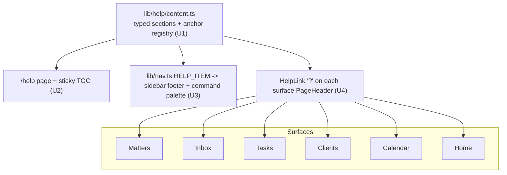

# feat: In-app Help section

Add a navigable in-app Help surface that teaches a solo lawyer how to use Legal Owl: an orientation,
step-by-step guides for the core workflows, and a plain-language glossary of the domain entities
(Client → Engagement → Matter → Action, plus Hearings, Deadlines, Documents, the court timeline,
Inbox/triage items, Tasks, and workflow states) with their key properties and relationships. It is a
real authenticated route (`/help`), reachable from the sidebar and command palette, with lightweight
per-surface "?" deep-links into the relevant section.

All paths are relative to `apps/web/`.

---

## Problem frame

A new lawyer landing in the app has no in-product explanation of what a "Matter" vs an "Engagement"
is, how triage works, or how to perform the core flows. The domain vocabulary (Client → Engagement →
Matter → Action) is non-obvious, and onboarding is currently a one-shot screen. There is no reference
surface a lawyer can return to. This plan adds that reference surface inside the app.

**Success criteria:** a lawyer can, without leaving the app, (1) read how to perform every core
workflow, (2) look up any domain entity and understand its properties and relationships, and (3) jump
to the relevant help from the surface they're on. Correctness gate after each unit: `npm run build`
(tsc + route gen) stays green (the repo has no test runner — see Testing reality).

---

## Requirements

- **R1** — A `/help` route exists inside the authenticated app, gated by the same auth/waitlist layout
  as every other in-app surface.
- **R2** — Help is a single long page with a sticky in-page table of contents and anchored sections
  (Getting started · Core workflows · Entity glossary · FAQ), each section deep-linkable via `#anchor`.
- **R3** — The Entity glossary documents each domain entity with a plain-language description, its key
  user-facing properties, and its relationships to other entities. Source of truth for the underlying
  fields is `lib/types.ts`.
- **R4** — The Core workflows section gives step-by-step guides for: add a matter; triage the Inbox
  (accept / snooze / dismiss + undo); manage Tasks (create, group, status/priority); log hearings &
  deadlines; upload & manage documents; add a client + the conflict check; edit Settings; the
  calendar / overdue view.
- **R5** — Help is reachable from the sidebar (footer, alongside Settings) and from the command
  palette ("Go to" group).
- **R6** — Each major surface (Matters, Inbox, Tasks, Clients, Calendar, Home) carries a small "?"
  affordance that deep-links to the relevant `/help#<anchor>`.
- **R7** — Help content is authored as maintainable structured data with a centralized anchor
  registry, so the page TOC, the command-palette entry, and the per-surface "?" links all reference
  the same anchor ids (no drift).

---

## Testing reality (read before the per-unit scenarios)

The repo has **no test runner** (`CLAUDE.md`: "no test suite yet; `npm run build` is the correctness
gate"). Test scenarios below are **behavioural verification scenarios** verified by build + manual run.
The one pure-logic seam worth a real unit test if a runner is added is the anchor-registry/TOC
derivation (U1). Introducing a harness is out of scope.

---

## Key Technical Decisions

- **KTD1 — Author help content as typed structured data, not inline JSX.** A `lib/help/content.ts`
  exports a typed array of sections → articles (blocks of prose, ordered steps, and glossary entries),
  each with a stable `id`. The page renders it generically. _Rationale:_ centralizes the anchor
  registry (R7), keeps content editable without touching layout, and lets the TOC, command palette,
  and per-surface "?" links all reference one source. _Trade-off:_ a small generic renderer vs.
  hand-laid JSX — worth it for maintainability and drift-freedom.
- **KTD2 — The glossary is hand-written user-facing prose, not auto-derived from `lib/types.ts`.**
  Users should see "Next hearing", not `next_hearing_date`. Field meanings are authored by hand with
  `lib/types.ts` as the reference. _Trade-off:_ manual sync risk if the schema changes — mitigated by
  a one-line "keep in sync with lib/types.ts" note and a stable, small entity set.
- **KTD3 — `/help` lives in the `app/(app)/` authenticated group** (in-app help for logged-in
  lawyers), as a single page with a sticky TOC. _Rationale:_ matches the user decision (one anchored
  page) and the project's read-surface = Server Component convention; no public/marketing duplication.
- **KTD4 — Help is a standalone nav item (like Settings), added to `lib/nav.ts` as `HELP_ITEM` and
  included in `ALL_NAV`.** _Rationale:_ the sidebar footer and command palette already consume the nav
  source of truth; adding it there gets R5 in both places with no duplication.
- **KTD5 — Per-surface "?" is one reusable `HelpLink` component placed in each surface's `PageHeader`
  actions slot (Home uses its quick-action row).** It takes an anchor id from the registry and links
  to `/help#<id>`. _Rationale:_ `PageHeader` already exposes a right-aligned actions slot; one
  component keeps placement consistent and anchors type-checked against the registry.
- **KTD6 — Static content, Server Component page; the sticky-TOC + smooth-scroll is a small client
  island.** No data fetching. _Rationale:_ help content is static; only the TOC interaction needs the
  client.

---

## High-Level Technical Design

One content registry feeds three consumers, so anchors never drift (R7):

Anchor ids are defined once in `content.ts`; `HelpLink` and the TOC accept only those ids, so a
renamed/removed section surfaces as a type error rather than a dead link.

---

## Implementation Units

### U1. Help content model + content
**Goal:** A typed content registry with the actual Help copy and a centralized anchor registry.
**Requirements:** R3, R4, R7.
**Dependencies:** none.
**Files:** `lib/help/content.ts` (new); optionally `lib/help/types.ts` (new) for the shapes.
**Approach:** Define a small typed model — `HelpSection { id, title, blocks }` where a block is a
discriminated union (prose paragraph, ordered step list, glossary entry `{ term, whatItIs,
properties: {label, meaning}[], relatesTo: string[] }`). Export the ordered `HELP_SECTIONS` array and
a derived `HELP_ANCHORS` union/const of section ids used by the TOC, `HelpLink`, and nav. Author the
content:
- **Getting started:** what Legal Owl is; the Client → Engagement → Matter → Action mental model in
  one paragraph; the first three things to do.
- **Core workflows** (one sub-block each, per R4): add a matter; triage the Inbox (accept→task,
  snooze with chosen duration, dismiss, undo); Tasks (quick-create, time-horizon grouping,
  status/priority); hearings & deadlines; documents (upload/download/delete, timeline); add a client +
  conflict check; calendar & overdue; Settings (profile/firm, data residency).
- **Entity glossary** (per R3, mirroring `lib/types.ts`): Client, Engagement, Matter, Action (Task),
  Hearing, Deadline, Document, Court event / timeline, Remark, Triage item (Inbox), Workflow state,
  Forum, Priority — each with friendly properties + relationships.
- **FAQ:** a handful (access/waitlist, data residency, where data syncs from, why a matter needs a
  client).
**Patterns to follow:** label maps in `lib/types.ts` (`FORUM_LABELS`, `STATE_TYPE_LABELS`,
`PRIORITY_LABELS`, `MATTER_STATUS_LABELS`, `CLIENT_STATUS_LABELS`) as the property-name reference;
existing typed-const style in `lib/nav.ts`.
**Test scenarios:**
- Every section `id` in `HELP_SECTIONS` is unique (a duplicate would break anchors/TOC).
- `HELP_ANCHORS` derives from `HELP_SECTIONS` so the two cannot drift.
- Glossary entries exist for every entity in R3; each lists ≥1 property and its relationships.
- `Test expectation: none` for pure prose content; the id-uniqueness/derivation is the unit-testable seam if a runner is added.
**Verification:** importing `HELP_SECTIONS`/`HELP_ANCHORS` typechecks; content covers all R4 workflows and R3 entities.

### U2. `/help` page + sticky TOC renderer
**Goal:** Render the registry as one anchored page with a sticky table of contents.
**Requirements:** R1, R2.
**Dependencies:** U1.
**Files:** `app/(app)/help/page.tsx` (new, Server Component); `components/help/help-toc.tsx` (new,
client — sticky nav + smooth scroll, optional scroll-spy); optionally `components/help/help-section.tsx`
(renderer for a section's blocks).
**Approach:** Page is a two-column layout at `lg` (sticky TOC left/right, content column) collapsing to
a single column on mobile (mirror the Home two-pane pattern). Use `PageHeader` for the title, render
each `HELP_SECTIONS` entry as a `SectionCard`/section with an `id={section.id}` anchor and
`scroll-mt-20` for sticky-header offset. Glossary entries render as a definition list (reuse the
`DetailRow`-style label/value pattern). TOC lists section titles as `#id` links; the client island
handles active-section highlight + smooth scroll, respecting reduced-motion.
**Patterns to follow:** `components/page-header.tsx` (`PageHeader`, `SectionCard`); the two-pane grid +
`scroll-mt` anchor pattern from `app/(app)/home/page.tsx` and the landing `#waitlist` anchor; the
client-island + reduced-motion pattern in `components/reveal.tsx`.
**Test scenarios:**
- `/help` renders under the authenticated layout (redirects to `/login` when signed out — inherited
  from `app/(app)/layout.tsx`).
- Every TOC link targets an existing section `id`; clicking scrolls to that section.
- Visiting `/help#<id>` for each anchor lands on the right section (offset by the sticky header).
- Page renders with no console errors; layout is single-column on small screens, two-column at `lg`.
**Verification:** navigate to `/help`, click each TOC entry and load each `#anchor` directly; build green.

### U3. Nav + command-palette integration
**Goal:** Make Help reachable from the sidebar and the command palette.
**Requirements:** R5.
**Dependencies:** U2 (route must exist).
**Files:** `lib/nav.ts` (add `HELP_ITEM`, include in `ALL_NAV`); `components/app-sidebar.tsx` (render
Help in the footer next to Settings); `components/command-palette.tsx` (no change if it maps
`ALL_NAV`; verify Help appears in "Go to").
**Approach:** Add `HELP_ITEM = { href: "/help", label: "Help", icon: <lucide help/circle-help>,
description: "How to use Legal Owl" }` mirroring `SETTINGS_ITEM`, and append it to `ALL_NAV`. In the
sidebar footer, render a Help menu button above/below the Settings button using `isActivePath`. The
command palette already maps `ALL_NAV` in its "Go to" group, so Help appears automatically — verify,
don't duplicate.
**Patterns to follow:** `SETTINGS_ITEM` + footer rendering in `components/app-sidebar.tsx`; the
`ALL_NAV` "Go to" mapping in `components/command-palette.tsx`.
**Test scenarios:**
- Help appears in the sidebar footer and routes to `/help`; active state highlights on `/help`.
- Help appears in the command palette "Go to" group and navigates correctly.
- `titleForPath("/help")` resolves to "Help" (header breadcrumb/title correctness).
**Verification:** Help reachable from both entry points; build green.

### U4. Per-surface "?" deep-links
**Goal:** A small "?" on each major surface that jumps to the relevant Help section.
**Requirements:** R6, R7.
**Dependencies:** U1 (anchor registry), U2 (anchors exist).
**Files:** `components/help/help-link.tsx` (new, client or server `Link`); edits to
`app/(app)/matters/page.tsx`, `app/(app)/inbox/page.tsx`, `app/(app)/tasks/page.tsx`,
`app/(app)/clients/page.tsx`, `app/(app)/calendar/page.tsx`, `app/(app)/home/page.tsx`.
**Approach:** `HelpLink` takes an `anchor` typed against `HELP_ANCHORS` and renders a quiet icon
button (`CircleHelp`, muted, `aria-label`) linking to `/help#${anchor}`. Place it in each surface's
`PageHeader` actions slot (the `children`); on Home, place it in the quick-action row. Map each
surface to its anchor (Matters→matters/add-a-matter, Inbox→triage, Tasks→tasks, Clients→clients,
Calendar→calendar, Home→getting-started).
**Patterns to follow:** `PageHeader` actions slot usage in `app/(app)/matters/page.tsx` and
`app/(app)/clients/page.tsx`; the existing quiet icon-button styling (e.g. `CopyChip`); Base UI rule —
set `type="button"` if rendered as a button (or use a `Link`).
**Test scenarios:**
- Each surface shows the "?" and it links to the correct `/help#<anchor>`.
- The `anchor` prop only accepts registry ids (a typo is a type error, not a dead link).
- Adding the "?" does not disturb existing header actions (e.g. Matters "+ New matter" still present).
**Verification:** click the "?" on each surface and land on the matching Help section; build green.

---

## Scope Boundaries

**In scope:** U1–U4 — the `/help` anchored page, content (workflows + entity glossary + getting
started + FAQ), nav + command-palette entry, and per-surface "?" deep-links.

### Deferred to Follow-Up Work
- In-help **search/filter** over content.
- **MDX or a CMS** for content authoring (structured TS is enough at this size).
- **Per-field contextual tooltips** inside forms (distinct from the per-surface "?").
- **Interactive/product tours** or first-run coachmarks (the existing onboarding screen stays as is).
- **Public/marketing docs site** or exporting help externally.
- **Localization** of help content.

### Out of scope (product identity — see STRATEGY.md)
- Anything implying associate coordination, billing, or enterprise-firm features.

---

## System-Wide Impact

- Adds one authenticated route and one nav item; touches six surface pages only to add a "?" link
  (additive, no behavior change).
- `lib/nav.ts` gains `HELP_ITEM` — consumed by sidebar + command palette automatically; verify both.
- No new dependencies, no DB/migration, no env, no external contracts.
- Affected parties: solo-lawyer end users (new help surface); no operational impact.

---

## Risks & Mitigations

- **Glossary drift from `lib/types.ts` (KTD2):** schema changes could make help stale. Mitigation:
  centralize entity copy in `content.ts` with a "sync with lib/types.ts" note; the entity set is small
  and stable.
- **Anchor/TOC drift:** mitigated by deriving `HELP_ANCHORS` from `HELP_SECTIONS` and typing `HelpLink`
  against it (a bad anchor is a build error).
- **Content scope creep:** help can balloon. Mitigation: one page, fixed top-level sections; extra
  depth goes to the deferred list.

---

## Dependencies / Sequencing

U1 (content + anchors) → U2 (page) → U3 (nav) and U4 (per-surface links) in parallel after U2.
Recommended order: U1 → U2 → U3 → U4. Build-gate after each.

---

## Sources & Research

- Domain entities + properties: `lib/types.ts` (source of truth for glossary fields).
- Nav source of truth: `lib/nav.ts` (`NAV_SECTIONS`, `SETTINGS_ITEM`, `ALL_NAV`, `titleForPath`,
  `isActivePath`).
- Design atoms: `components/page-header.tsx` (`PageHeader`, `SectionCard`, `EmptyState`); anchor +
  two-pane patterns in `app/(app)/home/page.tsx` and `app/page.tsx`; reduced-motion island in
  `components/reveal.tsx`.
- Conventions: `CLAUDE.md` (Server Components for reads, Base UI `render`/`type="submit"`, dd-MMM
  dates, `npm run build` gate).
- Product framing for the workflows/entities: `docs/design/benchmarks/README.md` and
  `docs/ARCHITECTURE.md` (Client → Engagement → Matter → Action hierarchy).
