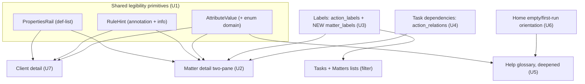

# feat: Model-faithful, self-describing UX

Make Legal Owl read like Linear: the UI is a faithful mirror of the data model, so a solo lawyer is
always confident they understand the structure, attributes, rules, and what-happens. Confidence comes
from **self-describing surfaces** — every record teaches in place via one consistent "record shell"
(attributes + status + valid actions + relations + activity), with the model's **rules made visible**.
This plan also completes the model by surfacing cheap dormant features (labels, lifecycle/sync,
task dependencies) and adds light-touch education on Home + a deepened Help glossary.

Paths are relative to `apps/web/` unless noted (migrations live at repo-root `supabase/migrations/`).

---

## Requirements (from origin)

Traces to `docs/brainstorms/2026-06-22-model-faithful-ux-requirements.md` (R1–R8, F1–F5, AE1–AE5):

| Origin | Theme | Unit |
|---|---|---|
| R1, R8 | Consistent "record shell" primitives | U1 |
| R1, R3, R4, R5b | Matter as flagship self-describing object (facts rail + rules + lifecycle/sync) | U2 |
| R5a | Labels/tagging on tasks **and** matters | U3 |
| R5c | Task dependencies (blocks/blocked_by/related) | U4 |
| R6 | Help glossary deepened to full schema fidelity | U5 |
| R7 | Home light-touch education | U6 |
| R1, R8 | Apply the shell to Client (consistency) | U7 |
| R2 | Constrained/legible state — light (see KTD7) | U2, U4 |

---

## Key Technical Decisions

- **KTD1 — One reusable "record shell" primitive set, consumed everywhere.** A `PropertiesRail`
  (definition-list of attributes), a `RuleHint` (subtle inline hint + info affordance), and an
  `AttributeValue` helper that can show an enum value alongside its allowed domain. Consistency *is* the
  product (R8) — no surface invents its own layout. _Rationale:_ build the legibility once, apply many.
- **KTD2 — Matter detail = two-pane** (persistent facts/properties rail + the existing tabs for heavy
  collections), not single-scroll, not tabs-only (user decision). _Rationale:_ legible-at-a-glance record
  + organized collections; most Linear-like.
- **KTD3 — Labels taggable on tasks AND matters.** `action_labels` already exists; add a parallel
  `matter_labels` join (small additive migration), RLS `auth.uid() = lawyer_id`. _Rationale:_ user wants
  matter tagging for organizing the case list; mirror the existing pattern.
- **KTD4 — Rules shown as subtle annotations, not prose.** `RuleHint` surfaces computed/invariant rules
  (next-hearing computed from earliest scheduled hearing; deadlines by-rule; append-only timeline;
  per-lawyer isolation) inline with an info affordance — visible, never cluttering.
- **KTD5 — Help glossary stays hand-authored structured data** (`lib/help/content.ts`), deepened to full
  schema fidelity and **manually** synced with `lib/types.ts` + migrations. _Rationale:_ codegen is
  deferred scope; the entity set is small and stable (see origin assumption).
- **KTD6 — Surface dormant features *where they belong in the shell*,** not as separate pages: lifecycle
  + sync in the facts rail; labels in properties + list filters; dependencies in a task's relations.
  _Rationale:_ reinforces "the UI mirrors the model."
- **KTD7 — Keep state pickers light.** Continue rendering workflow states as badges (the shipped
  `status-control`); do not build a hard transition state-machine engine now. Genuinely constrained
  transitions that already exist (hearing scheduled→held/adjourned) stay as-is. _Rationale:_ simplicity.

---

## High-Level Technical Design

The shell primitives feed every entity surface and the Help glossary; the only schema change is the
additive `matter_labels` join.



Matter facts rail (the flagship) consolidates what's scattered today:

```
[ key  CNR ]  status-badge   lifecycle • last-synced
Forum · case_type · parties (petitioners v respondents)
Client → Engagement        Next hearing  ⓘ computed from earliest scheduled hearing
Counts: hearings · deadlines · documents · open tasks      Labels: [pro-bono] [+]
Valid actions: Edit details · Set status · Add hearing/deadline · Archive
```

---

## Implementation Units

### Phase A — Shared legibility primitives

### U1. Record-shell primitives
**Goal:** Reusable components that make any record self-describing consistently.
**Requirements:** R1, R8.
**Dependencies:** none.
**Files:** `components/record/properties-rail.tsx` (new), `components/record/rule-hint.tsx` (new),
`components/record/attribute-value.tsx` (new); optional `lib/domain-labels.ts` (new) mapping each enum to
a display label + its allowed-set (reuse the label maps in `lib/types.ts`).
**Approach:** `PropertiesRail` renders a titled definition-list of `{label, value}` rows (the
`DetailRow` pattern already in `clients/[id]/page.tsx`, promoted + generalized). `RuleHint` is a quiet
inline element (icon + short text, with a popover/tooltip for the full rule) — server-renderable where
possible, client only if the popover needs it. `AttributeValue` formats a value and can show its enum
domain (e.g. forum_type → "High Court" with the 8-value set on hover/expand), pulling from the
`*_LABELS` maps. Keep them theme-consistent (mint/lemon dark, badge system).
**Patterns to follow:** `DetailRow` in `app/(app)/clients/[id]/page.tsx`; `SectionCard`/`PageHeader` in
`components/page-header.tsx`; label maps in `lib/types.ts`; `hover-card`/`popover` primitives in
`components/ui/`.
**Test scenarios:**
- Covers R1. `PropertiesRail` renders each `{label,value}` row; empty/null values render as "—", not blank.
- `AttributeValue` for an enum shows the friendly label and exposes its allowed domain.
- `RuleHint` shows the short text inline and the full rule on the info affordance; respects reduced-motion.
- `Test expectation:` mostly presentational; the enum-domain mapping is the unit-testable seam if a runner is added.
**Verification:** components render in isolation and are consumed by U2/U7; `npm run build` green.

---

### Phase B — Flagship: Matter as one legible object

### U2. Matter detail two-pane (facts rail + rules + lifecycle/sync)
**Goal:** Turn the matter page into one legible object: a persistent facts/properties rail beside the
existing activity tabs.
**Requirements:** R1, R3, R4, R5b, R2.
**Dependencies:** U1.
**Files:** `app/(app)/matters/[id]/page.tsx`; reuse `components/record/*` (U1); `components/matter/*`.
**Approach:** Two-column at `lg` (rail + tab area), single column on mobile. The rail uses `PropertiesRail`
to show **every** stored attribute (key + CNR with the existing `CopyChip`, forum, case_type, parties,
matter_status, **lifecycle_state + last_successful_sync_at** read-only, client→engagement link, and
counts of hearings/deadlines/documents/open tasks), the matter's **valid actions** (edit details, set
status, add hearing/deadline, archive), and `RuleHint`s for the computed/invariant rules (next-hearing
computed; the court_events+remarks timeline is append-only). Keep the existing tabs (Timeline/Tasks/
Hearings/Deadlines/Documents) for the heavy collections.
**Patterns to follow:** current `app/(app)/matters/[id]/page.tsx` (tabs, timeline merge, `CopyChip`,
`MatterStatusControl`); the two-pane grid from `app/(app)/home/page.tsx`.
**Test scenarios:**
- Covers AE1. Every stored matter attribute appears in the rail (no unsurfaced columns); id + CNR copy; lifecycle + last-sync shown.
- Next-hearing shows a `RuleHint` ("computed from earliest scheduled hearing"); the timeline is labelled append-only.
- At `lg` the rail + tabs render side by side; on mobile they stack; existing tab actions still work.
- A matter with no CNR / no client renders cleanly (no broken rows).
**Verification:** open a seeded matter → the whole case file is legible at a glance; tabs intact; build green.

---

### Phase C — Complete the model (cheap dormant features)

### U3. Labels on tasks and matters
**Goal:** Activate tagging across the two most useful entities.
**Requirements:** R5a.
**Dependencies:** none (U1 optional for display).
**Files:** `supabase/migrations/20260622000002_matter_labels.sql` (new); `app/(app)/.../actions.ts` for
label CRUD + assign (co-located per route); label chip rendering via `components/badges.tsx` or a new
`components/label-chip.tsx`; filter UI on `app/(app)/matters/page.tsx` and `app/(app)/tasks/page.tsx`.
**Approach:** Migration adds `matter_labels (lawyer_id, matter_id, label_id)` mirroring `action_labels`,
with RLS `auth.uid() = lawyer_id` and a unique `(matter_id, label_id)`. Server actions: create label,
assign/unassign to a task and to a matter. Render label chips (use `labels.color`) on the matter facts
rail and task rows; add a "filter by label" control to the Matters and Tasks lists.
**Execution note:** apply the migration with `supabase db push` (session pooler per CLAUDE.md).
**Patterns to follow:** existing `action_labels` table + the `clients_documents` migration's RLS style;
the filter-chip pattern already on Matters/Tasks; matter tab-count query for label counts.
**Test scenarios:**
- Covers R5a / AE5. Create a label, assign it to a task and to a matter; both show the chip.
- RLS: a second lawyer cannot read/assign another's labels or label-links (verify with two UIDs).
- Filtering Matters/Tasks by a label returns only tagged rows; clearing restores all.
- Unique constraint prevents duplicate (matter,label) assignment; unassign removes the chip.
**Verification:** label a matter and a task, filter by it; migration applies cleanly; build green.

### U4. Task dependencies (blocks / blocked_by / related)
**Goal:** Surface and edit `action_relations` so task dependencies are visible.
**Requirements:** R5c.
**Dependencies:** none.
**Files:** `app/(app)/matters/[id]/actions.ts` (add relation create/remove); `components/matter/task-list.tsx`
(show + manage relations); reuse `components/record/*` for the relations display.
**Approach:** On a task, show its relations (blocks / blocked_by / related → linked tasks) and an
affordance to add/remove a relation to another task in the same matter. A `blocked_by` task shows a
clear "blocked" indicator. Since there's no dedicated task-detail page, surface this inline on the
matter's Tasks tab (expandable row or a small "Relations" popover) — exact affordance is an
implementation call.
**Patterns to follow:** `action_relations` table (kind enum: blocks/blocked_by/related); the existing
inline task row + `useTransition` action pattern in `components/matter/task-list.tsx`; `popover` primitive.
**Test scenarios:**
- Covers R5c. Mark task A "blocked by" task B → A shows a blocked indicator and the link; B shows it blocks A.
- Adding a "related" link shows on both tasks; removing it clears both.
- A task can't depend on itself; duplicate relations are prevented.
- Relations are scoped to the matter's own tasks (no cross-matter linking in this slice).
**Verification:** create a blocks/blocked-by pair and see it on both tasks; build green.

---

### Phase D — Education

### U5. Deepen the Help glossary to full schema fidelity
**Goal:** Make the Help glossary exhaustively true to the model.
**Requirements:** R6, F3, AE3.
**Dependencies:** none.
**Files:** `lib/help/content.ts` (extend the glossary entries).
**Approach:** Expand every glossary entry to list **all** attributes (with enum domains, e.g. forum_type's
eight values), relations, the entity's lifecycle/state machine where it has one, and its rules — derived
from `lib/types.ts` + `supabase/migrations/`. Add entries for anything missing (engagement, label,
action_relation, lifecycle_state). Keep the existing `HELP_SECTIONS` shape and anchors.
**Patterns to follow:** existing `HELP_SECTIONS`/glossary in `lib/help/content.ts`; the `*_LABELS` maps
and enum definitions in `lib/types.ts`; the live schema (source of truth).
**Test scenarios:**
- Covers AE3. Help → "Matter" lists every attribute with its enum domain, its relations, and its rules.
- Every entity in the live schema has a glossary entry; each lists ≥1 attribute + its relations.
- `Test expectation: none` for prose; entry-coverage is the checkable property if a runner is added.
**Verification:** /help glossary covers every entity/attribute/relation/rule; build green.

### U6. Home light-touch education
**Goal:** Teach the model on Home without cluttering the command center.
**Requirements:** R7, F4, AE4.
**Dependencies:** none (links to U5's Help).
**Files:** `app/(app)/home/page.tsx`; optional `components/model-orientation.tsx` (new).
**Approach:** In empty/first-run states (the existing `Onboarding` branch and empty sections), show a
compact "How Legal Owl is structured: Client → Engagement → Matter → Action" orientation card that links
into the deepened Help; add a small persistent entry to Help. Once the lawyer has matters/work, the
orientation recedes (only the small Help entry remains). Command center otherwise unchanged.
**Patterns to follow:** the `Onboarding` branch + `EmptyState` in `app/(app)/home/page.tsx`; the
`HelpLink` pattern from this session.
**Test scenarios:**
- Covers AE4. A brand-new account (no matters) shows the orientation + Help link; with data, it recedes.
- The orientation links to the correct Help anchors; the persistent Help entry is always reachable.
**Verification:** new vs populated account show the right Home; build green.

---

### Phase E — Consistency to Client

### U7. Client detail self-describing
**Goal:** Apply the record shell to the client page for cross-entity consistency.
**Requirements:** R1, R8.
**Dependencies:** U1.
**Files:** `app/(app)/clients/[id]/page.tsx`; reuse `components/record/*`.
**Approach:** Reframe the client page to lead with a `PropertiesRail` (type, status, email, phone,
address, GSTIN/PAN — org-only where applicable), relations (engagements, matters, contacts with counts),
and the valid actions; keep the conflict artifact + matters/engagements/contacts sections. Apply the
same `RuleHint`/labels conventions (e.g. "General engagement auto-created"). Replace the local `DetailRow`
with the shared `PropertiesRail` (U1).
**Patterns to follow:** current `app/(app)/clients/[id]/page.tsx` (DetailRow, conflict block, sections);
`components/record/*` (U1).
**Test scenarios:**
- Covers R1/R8. Client page renders all captured attributes via `PropertiesRail`; org shows GSTIN/PAN, individual omits them.
- Relations (engagements/matters/contacts) show with counts and navigate correctly.
- The local DetailRow is removed in favour of the shared primitive (no duplicate).
**Verification:** client page matches the matter's legible shape; build green.

---

## Testing reality
No test runner exists (`CLAUDE.md`: `npm run build` is the gate). Scenarios above are behavioural —
verified by build + manual run. The genuinely unit-testable seams if a runner is added: the
enum-domain mapping (U1) and the `matter_labels` RLS (U3, two-UID check).

---

## Scope Boundaries

**In scope:** U1–U7 — the record-shell primitives, Matter two-pane flagship, labels (tasks + matters),
task dependencies, deepened Help, Home education, Client consistency.

### Deferred to Follow-Up Work
- Court-monitoring **automation** (eCourts sync infra) — this plan only *displays* lifecycle/sync.
- Deadline rule-**engine** auto-computation; action **templates**; **AI-grounding** surface; **kanban**
  over workflow_states; a dedicated task-detail page; codegen to auto-sync the Help glossary from schema.
- Applying the full shell to every minor entity beyond Matter and Client.

### Out of scope (product identity — STRATEGY.md)
- Associate/team task coordination, invoicing, enterprise-firm features.

---

## System-Wide Impact
- New shared `components/record/*` primitives become consumed across Matter and Client — change carefully after.
- One additive migration (`matter_labels`), RLS-guarded; first label join beyond `action_labels`.
- No external contracts, env, or dependency changes.
- Affected parties: solo-lawyer end users (every core surface reads more legibly).

---

## Risks & Mitigations
- **Matter two-pane reframe regresses the busy matter page (U2):** keep the existing tabs + actions intact;
  the rail is additive. Verify each tab still works after.
- **`matter_labels` RLS (U3):** additive, low risk; verify with two UIDs; apply via session pooler.
- **Task-dependency UI placement (U4):** no task-detail page exists; inline affordance chosen — keep it
  unobtrusive on the Tasks tab; cross-matter linking explicitly out.
- **Help glossary drift (U5):** accepted (KTD5) — manual sync; small stable entity set.

---

## Dependencies / Sequencing
U1 first (primitives) → U2 + U7 consume it. U3, U4, U5, U6 are independent and can follow in any order.
Recommended: U1 → U2 → U3 → U4 → U5 → U6 → U7. Build-gate after each.

---

## Sources & Research
- Origin: `docs/brainstorms/2026-06-22-model-faithful-ux-requirements.md` (R/F/AE).
- Live schema (entities/attributes/enums/FKs) — source of truth for the glossary + facts rail.
- Existing assets: `components/badges.tsx`, `components/page-header.tsx`, `lib/help/content.ts`,
  `app/(app)/matters/[id]/page.tsx`, `app/(app)/clients/[id]/page.tsx`, `lib/types.ts`,
  `supabase/migrations/20260621000005_clients_documents.sql` (RLS + action_labels pattern).
- Conventions: `CLAUDE.md` (Server Components read / Server Actions write, Base UI, dd-MMM dates,
  RLS `auth.uid()=lawyer_id`, `npm run build` gate, migration apply command).
