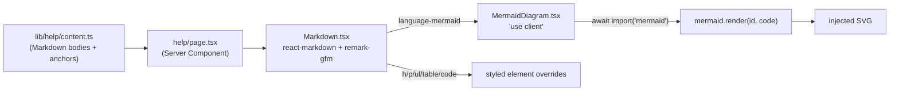
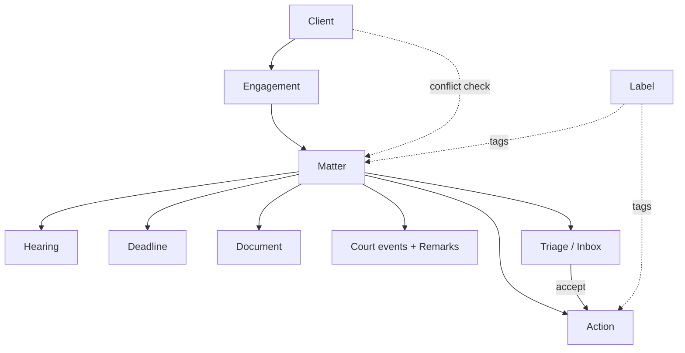

# feat: Succinct Help with GitHub-flavored Markdown + Mermaid

## Summary

Rewrite the in-app Help page (`apps/web/app/(app)/help/`) to be **succinct** and to render **GitHub-flavored Markdown + Mermaid diagrams**, so a lawyer can see at a glance *what the entities are*, *how they connect*, and *how the whole app works*. Today Help is a long wall of typed `prose`/`steps`/`glossary` blocks (a 15-entry glossary alone). We replace the rendering substrate with a small Markdown pipeline (react-markdown + remark-gfm) plus a lazy client-loaded Mermaid island, then re-author the content as tight Markdown anchored by two diagrams: an **entity map** and a **"how it works" flow**.

This is a UI + content change only. The domain model, other pages, and the single-column Help route/layout (recently flattened) are unchanged.

---

## Problem Frame

- **Verbose.** The current Help (`apps/web/lib/help/content.ts`) is exhaustive reference prose — every field of every entity spelled out in a 15-entry glossary. It reads like a schema dump, not an orientation.
- **No mental model.** Nothing shows how Client → Engagement → Matter → Action fit together, or how a court update becomes a task on the Calendar. The relationships exist only as bullet lists ("relatesTo").
- **No rich rendering.** The content model (`prose | steps | glossary`) can't express tables, emphasis, or diagrams, so the natural tools for "explain a system" (an ER diagram, a flowchart) aren't available.

**Goal:** a Help page that orients in one scroll — short prose, GFM where it helps, and two Mermaid diagrams that carry the structure — backed by a rendering pipeline we can reuse later.

---

## Requirements

- **R1.** Help renders GitHub-flavored Markdown (headings, **bold**, lists, tables, inline code, links) from first-party content.
- **R2.** Help renders Mermaid diagrams from ` ```mermaid ` fenced blocks, drawn client-side and themed to the app's off-dark palette.
- **R3.** Content is materially shorter than today — the schema-dump glossary is replaced by an entity map diagram plus a compact reference, and each workflow section is trimmed to essentials.
- **R4.** Two authored diagrams: (a) an **entity relationship map** (Client → Engagement → Matter → Action and the records that hang off a Matter), and (b) a **"how the app works" flow** (court update → Inbox → task → Calendar/Home; the four product tracks).
- **R5.** Preserve Help's integration contracts: the `HELP_ANCHORS` registry, per-section `id`/`title`/`group`, deep-links from the per-surface `?` `HelpLink`, and command-palette references must keep working (a bad anchor stays a type error).
- **R6.** Single-column `PageShell` layout, off-dark theme, and `npm run build` green gate are preserved. Mermaid must never run on the server (no `document is not defined`) and must stay out of the initial bundle.

---

## Key Technical Decisions

- **KTD1 — Markdown stack: `react-markdown@^10` + `remark-gfm@^4`, no `rehype-raw`.** Both are pure-ESM and render to React elements (server-safe). react-markdown strips raw HTML by default; we keep that default — content is first-party so we don't need `rehype-raw`, and avoiding it keeps the XSS surface closed. (Sources confirmed react-markdown 10.1.0, remark-gfm 4.0.1.)
- **KTD2 — Mermaid as a lazy client island (`mermaid@^11`).** A `"use client"` `<MermaidDiagram>` does `await import("mermaid")` inside `useEffect`, calls `mermaid.render(id, code)`, and injects the SVG. This keeps mermaid (~200 KB gzipped) out of the server bundle and the initial client chunk, and avoids `document is not defined`. Per-diagram `id` from `useId()` (colons stripped) prevents collisions across multiple diagrams; `suppressHydrationWarning` covers the intentional server-empty → client-SVG swap; a skeleton shows until render resolves.
- **KTD3 — Detect mermaid by language class, not the `inline` prop.** react-markdown v10 removed the `inline` arg to the `code` override; the reliable signal for a fenced mermaid block is `className === "language-mermaid"` (inline code never carries that class). Route those to `<MermaidDiagram>`; render everything else as styled code.
- **KTD4 — Style Markdown via element overrides, not `@tailwindcss/typography`.** Map `h1–h4`, `p`, `ul/ol/li`, `a`, `code`, `pre`, `table`, `blockquote` to the existing design-system classes (Geist/Source Serif, `text-muted-foreground`, `rounded-xl border`, mono for code) inside the renderer's `components`. Avoids a plugin and guarantees the off-dark theme stays consistent with the rest of the app.
- **KTD5 — Keep the typed anchor registry; change only the body representation.** `HELP_ANCHORS` and per-section `id`/`title`/`group` stay; each section's `blocks: HelpBlock[]` becomes a single `body: string` of Markdown. This preserves R5's invariants (TOC/deep-link/command-palette) while letting content be authored as Markdown.
- **KTD6 — Theme reactivity via `next-themes`.** `<MermaidDiagram>` reads `resolvedTheme` from `useTheme()` and passes `theme: 'base'` + `themeVariables` (hex values for the mint/lemon palette + Geist font) to `mermaid.initialize()`, re-rendering when theme or code changes. CSS-var `themeVariables` aren't stable yet — use hex.

---

## High-Level Technical Design

**Render pipeline** — content string flows server→client, mermaid splits off lazily:



**Authored content diagrams** (these are the *output* of U3 — the entity map and the flow the page will show). Directional intent for the entity map:



The "how it works" flow (U3) layers the four tracks onto that spine: **court monitoring** feeds Court events → **case management** (the Matter spine) → Inbox triage → tasks/Calendar/Home → **client experience** (updates). Exact diagram prose is authored in U3, not specified here.

---

## Implementation Units

### U1. Markdown renderer component + dependencies

**Goal:** A reusable, server-safe `<Markdown>` that renders GFM with design-system styling and routes mermaid fences to the client island.
**Requirements:** R1, R4, R6.
**Dependencies:** none.
**Files:**
- `apps/web/package.json` — add `react-markdown@^10`, `remark-gfm@^4`, `mermaid@^11`.
- `apps/web/components/markdown.tsx` — new server component.
- `apps/web/next.config.ts` — add `transpilePackages: ['react-markdown', 'remark-gfm']` **only if** Turbopack raises an ESM error at build (note inline; don't add pre-emptively).
**Approach:** `<Markdown content={string} />` wraps `ReactMarkdown` with `remarkPlugins={[remarkGfm]}` and a `components` map. The `code` override checks `className === "language-mermaid"` → returns `<MermaidDiagram code={String(children).trim()} />` (U2); all other elements get Tailwind classes mirroring the app's type scale and `badges`/`page-header` surfaces. No `rehype-raw`.
**Patterns to follow:** existing `components/` atoms (`badges.tsx`, `page-header.tsx`) for class vocabulary; `lib/utils.ts` `cn`.
**Test scenarios:**
- Renders headings/paragraphs/lists/links from a Markdown string (happy path).
- Renders a GFM table and inline `code` correctly (GFM features on).
- A ` ```mermaid ` fence yields a `<MermaidDiagram>`, not a `<pre><code>`.
- A non-mermaid fenced block (e.g. ` ```ts `) renders as a styled code block, not a diagram.
- Raw HTML in content is stripped/escaped (security — default behavior holds; no `rehype-raw`).
*Test expectation:* no test runner exists; verification is `npm run build` + visual. Capture these as the manual check-list in Verification.
**Verification:** `npm run typecheck`/`npm run build` green; a sample section renders prose + table; no raw-HTML execution.

### U2. Lazy client-side Mermaid island

**Goal:** Draw a mermaid diagram client-side, themed, without bloating the bundle or breaking SSR.
**Requirements:** R2, R6, KTD6.
**Dependencies:** U1 (consumed by the renderer; can be built in parallel but lands first or together).
**Files:**
- `apps/web/components/mermaid-diagram.tsx` — new `"use client"` component.
**Approach:** `useId()` (strip `:`) for a unique SVG id; `useEffect` does `const mermaid = (await import("mermaid")).default`, `mermaid.initialize({ startOnLoad:false, theme:'base', themeVariables:{…palette…} })`, then `const { svg } = await mermaid.render(id, code)` → store in state → render via `dangerouslySetInnerHTML` on a `suppressHydrationWarning` div. Show a skeleton while `svg` is empty and an inline error block on throw. `useTheme()` from `next-themes`; deps `[code, id, resolvedTheme]`. A `cancelled` guard prevents setState after unmount.
**Patterns to follow:** existing client islands using `useEffect`/`useTransition` (e.g. `components/tasks-list.tsx`, `components/demo-toggle.tsx`) for the `"use client"` shape; theme tokens from `app/globals.css`.
**Test scenarios:**
- A valid diagram string renders an inline SVG after mount (happy path).
- Two diagrams on one page get distinct ids and both render (no collision).
- Invalid mermaid syntax shows the error block, not a crash (failure path).
- Component never imports mermaid at module top — server render produces no `document` access (SSR safety).
- Switching theme re-renders with the dark palette (integration with next-themes).
*Test expectation:* manual (no runner) — list as Verification check-list.
**Execution note:** verify the SSR-safety scenario first (build must not crash) before theming polish.
**Verification:** `npm run build` green; Help page shows themed diagrams; mermaid appears as a separate async chunk, not in the initial JS.

### U3. Re-author Help content as succinct Markdown + diagrams

**Goal:** Replace the verbose typed blocks with tight Markdown, and add the entity map + "how it works" diagrams.
**Requirements:** R3, R4, R5.
**Dependencies:** none (content can be authored independently; renders once U1/U2 land).
**Files:**
- `apps/web/lib/help/content.ts` — change `HelpSection.blocks: HelpBlock[]` → `HelpSection.body: string` (Markdown). Keep `HELP_ANCHORS`, `HelpAnchor`, `id`/`title`/`group`. Remove the `HelpBlock`/`GlossaryEntry` types and the `prose|steps|glossary` data.
**Approach:** For each anchor, write 2–6 lines of Markdown instead of paragraphs + step lists. Fold the 15-entry glossary into (a) the **entity-map** mermaid diagram on `glossary` (or a new `overview` anchor) and (b) a compact GFM **table** of entity → one-line "what it is" (not every field). Add the **"how it works"** flow diagram to `getting-started`. Keep FAQ as a short GFM list. Preserve every existing anchor id in `HELP_ANCHORS` so deep-links don't break (R5); if consolidating, keep the anchor and point it at the right section.
**Patterns to follow:** current `content.ts` voice (neutral-professional, India litigation terms); domain hierarchy and entity names from `lib/types.ts` and the migrations (authoritative FK graph: Matter→Client is a loose link; Triage originates from a Court event and yields an Action; Labels join both Matters and Actions).
**Test scenarios:**
- Every `HELP_ANCHORS` id still resolves to a section (no orphaned deep-link). Covers R5.
- The entity-map and flow diagrams parse as valid mermaid (render without error).
- Content length is materially reduced (the per-field glossary is gone).
*Test expectation:* manual — anchor-resolution is a typecheck (anchors are typed) + visual scroll.
**Verification:** typecheck green (anchor union intact); page scrolls short; diagrams render; ⌘K / `?` deep-links land on the right sections.

### U4. Wire the Help page to the Markdown renderer

**Goal:** Render section `body` Markdown through `<Markdown>`, dropping the old block renderers.
**Requirements:** R1, R3, R5, R6.
**Dependencies:** U1, U3.
**Files:**
- `apps/web/app/(app)/help/page.tsx` — replace the `Block`/`GlossaryItem`/`prose`/`steps` rendering with `<Markdown content={section.body} />` per section. Keep `PageShell`, `PageHeader`, section `id` + `scroll-mt`, and the ⌘K hint.
**Approach:** Each `<section id={s.id} className="scroll-mt-20">` keeps its serif `<h2>` title and renders `<Markdown content={s.body} />` inside a `SectionCard` (or bare, per density). Delete the now-dead `Block`, `GlossaryItem`, `HelpBlock` imports/usages.
**Patterns to follow:** the page's current single-column `PageShell` structure (post-flatten); `SectionCard` from `page-header.tsx`.
**Test scenarios:**
- Each section renders its Markdown body (happy path).
- Anchors + `scroll-mt` still position correctly when deep-linked (integration with `HelpLink`).
- No references to removed `Block`/`glossary` types remain (build clean).
*Test expectation:* manual + build.
**Verification:** `npm run build` green; visual parity of structure (titles, anchors) with shorter bodies.

### U5. Theme polish + green-build verification

**Goal:** Diagrams match the off-dark palette; whole change passes the build gate and renders correctly.
**Requirements:** R6, KTD6.
**Dependencies:** U1–U4.
**Files:**
- `apps/web/components/mermaid-diagram.tsx` — finalize `themeVariables` (mint primary, lemon accent, muted lines, Geist font) for light/dark.
- (If needed) `apps/web/next.config.ts` — `transpilePackages` per U1 note.
**Approach:** Tune `themeVariables` against `app/globals.css` tokens (hex, not CSS vars). Confirm mermaid lazy-chunk, no SSR crash, no hydration warnings in console.
**Test scenarios:**
- Diagrams legible in the default (dark) theme; readable node/line contrast.
- No console hydration warning on the Help route.
- `npm run build` green; mermaid in a separate chunk.
*Test expectation:* manual visual + build.
**Verification:** build green; Help diagrams themed; bundle check shows mermaid split out.

---

## Scope Boundaries

**In scope:** the Help page content + the Markdown/Mermaid rendering infrastructure that serves it.

### Deferred to Follow-Up Work
- Reusing `<Markdown>` elsewhere (e.g. future AI-answer rendering) — built generically here, adopted later.
- Syntax highlighting for non-mermaid code blocks (`rehype-highlight`/Shiki) — not needed for Help.
- `@tailwindcss/typography` — intentionally avoided (KTD4); revisit only if hand-styling proves insufficient.
- A promise-queue/mutex around `mermaid.render()` — add only if many simultaneous diagrams collide (KTD2).

**Out of scope:** the domain model/schema, other routes, the Help route/single-column layout and nav (already settled), and the deep-link/command-palette wiring (preserved, not changed).

---

## Risks & Dependencies

- **Turbopack ESM strictness (Next 16).** Pure-ESM `react-markdown`/`remark-gfm` can trip Turbopack. *Mitigation:* add them to `transpilePackages` if (and only if) a build error appears; mermaid is never imported server-side so it's unaffected.
- **Bundle weight.** mermaid is ~200 KB gzipped. *Mitigation:* lazy `import("mermaid")` inside the client island keeps it out of the initial bundle (KTD2).
- **Hydration mismatch.** Server renders an empty container, client injects SVG. *Mitigation:* `suppressHydrationWarning` + render-after-mount (KTD2).
- **Anchor drift (R5).** Consolidating sections could orphan a deep-link. *Mitigation:* keep every `HELP_ANCHORS` id; the typed union makes a bad anchor a compile error.
- **Theme hex values.** Mermaid CSS-var `themeVariables` aren't stable — hardcoded hex can drift from `globals.css`. *Mitigation:* pull the few palette hexes from the theme tokens and keep them in one place in the island.

---

## Sources & Research

- react-markdown **10.1.0**, remark-gfm **4.0.1**, mermaid **11.x** — all ESM-only; React 19/Next 16 compatible. `code` override keys on `language-mermaid` (v10 dropped the `inline` arg).
- Mermaid client pattern: `await import("mermaid")` in `useEffect`, `mermaid.render(useId(), code)` → `dangerouslySetInnerHTML`, `suppressHydrationWarning`, skeleton; `startOnLoad:false`; theme via `base` + `themeVariables`.
- Security: react-markdown strips raw HTML by default — do **not** add `rehype-raw`.
- Next 16 Turbopack: `transpilePackages` is the escape hatch for ESM-only deps if build errors appear.
- Entity FK graph (for the diagram) from `supabase/migrations/20260621000001_case_workflow.sql` + `…0005_clients_documents.sql` + `…matter_labels.sql`.
