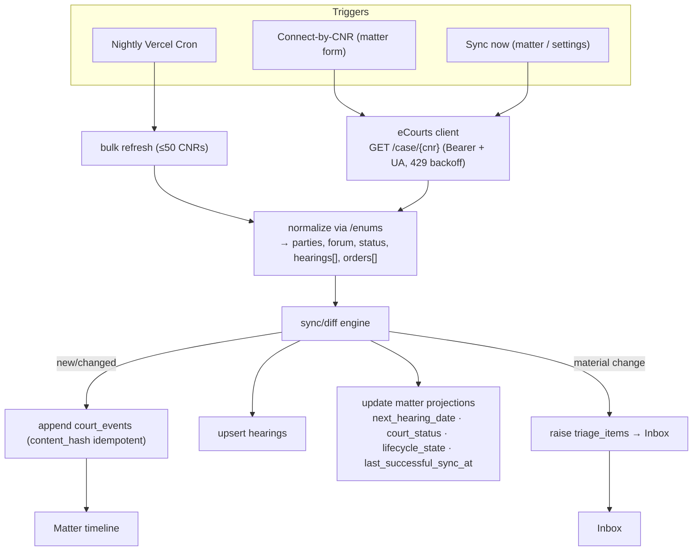
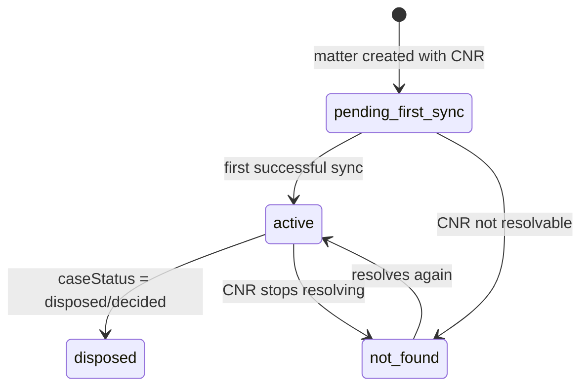

# feat: Working eCourts CNR sync, demo'd in "See it in action"

## Summary

Build a **genuinely working** eCourts connection: a typed client for the licensed `ecourtsindia.com` partner API, a reusable **CNR sync engine** that diffs case responses into the existing append-only `court_events` + `triage_items` + matter projections, and three surfaces over it — **Connect-by-CNR** on the matter form, a **nightly bulk cron**, and a per-matter **"Sync now"** — with **credit guardrails** and a `last_synced` staleness banner. Then make it demonstrable in **"See it in action"**: seed a **real public CNR** that live-syncs (D2) and offer **"Connect a real case"** to paste the lawyer's own CNR (D1), with a recorded fixture as the cost-safe fallback (D3).

Feasibility is firsthand-verified, not assumed: an authenticated `GET https://webapi.ecourtsindia.com/api/partner/enums` with the `.env` key returned **HTTP 200** with real data. CNR lookup is a single Bearer GET with no CAPTCHA. (See origin: `docs/ideation/2026-06-23-ecourts-connection.md`.)

---

## Problem Frame

The product's headline track is **court monitoring** ("Daily eCourts sync … no more portal checks"), but it is entirely unbuilt: the schema is ready (`court_events` append-only + `source_type`, `triage_items`, `matters.cnr/lifecycle_state/last_successful_sync_at`, `hearings`), yet there is **zero sync infrastructure** — no route handlers, no cron, and a disabled "Connect — soon" card in `apps/web/app/(app)/settings/page.tsx`. Demo `court_events` are fabricated with `source_type: "ecourt"`, so "See it in action" shows a *simulated* sync, not a real one. The Streamlit prototype (`prototype/ecourts-streamlit/`) reverse-engineered the API surface but is **mock-tested only** — its response field names were never verified against a live response, and its UI never actually auto-fetches.

---

## Requirements

- **R1.** A typed TS eCourts client calls the partner API: `GET /case/{cnr}`, bulk refresh (≤50 CNRs), and `/enums`; sends `Authorization: Bearer` **and a browser `User-Agent`** (Cloudflare 403s bare clients); handles `429` with exponential backoff and timeouts.
- **R2.** A reusable **sync engine**: given a matter + a fetched case, it diffs against stored state and lands changes idempotently into `court_events` (new order / hearing-date-changed / status-changed), upserts `hearings`, updates matter projections (`next_hearing_date`, `court_status`, `lifecycle_state`, `last_successful_sync_at`), and raises `triage_items` for material changes.
- **R3.** **Connect-by-CNR**: pasting a CNR on a matter fetches live and fills parties/forum/case-type/status/next-hearing + backfills hearing history and orders; `lifecycle_state` moves `pending_first_sync → active` (or `not_found`).
- **R4.** **Nightly bulk cron** syncs every matter with a CNR via the bulk endpoint and drops material changes into the Inbox.
- **R5.** Per-matter **"Sync now"** runs the engine live (5–10s) from the matter and from the Settings card (replacing "Connect — soon").
- **R6.** **Credit guardrails**: only successful calls cost; cache/dedup within a run; a per-account daily call cap; `429` backoff; surface remaining-credit awareness. `last_successful_sync_at` renders as a staleness "trust artifact."
- **R7.** **Demo**: "See it in action" seeds ≥1 real public CNR that genuinely live-syncs, plus a "Connect a real case" affordance for the lawyer's own CNR; fake sample matters stay, clearly marked Sample; a recorded fixture is the offline/cost-safe fallback.
- **R8.** Provenance integrity preserved: real synced events are `source_type: "ecourt"`; the existing Sample-data banner keeps demo data distinguishable.

---

## Key Technical Decisions

- **KTD1 — Provider + transport.** `ecourtsindia.com` partner API (`https://webapi.ecourtsindia.com/api/partner`), Bearer auth via `ECOURTS_API_KEY`. The client **must set a real `User-Agent`** — Cloudflare blocks bare HTTP-client UAs (verified). Keep the official `services.ecourts.gov.in` (CAPTCHA, no API) and NJDG (govt-only) out of scope; direct scraping is a ToS/IT-Act risk the licensed API avoids.
- **KTD2 — Diff into the existing append-only spine.** Reuse `court_events` (idempotent via its `content_hash` natural key — no provider IDs needed) + `remarks` timeline + `triage_items`. The sync engine is the single writer; the three surfaces are thin callers. This lands automation in the case-management foundation exactly as STRATEGY's court-monitoring track intends.
- **KTD3 — Verify the response schema before trusting the parser.** The prototype's `courtCaseData` field names (`nextHearingDate`, `historyOfCaseHearings[]`, `judgmentOrders[].orderUrl`, …) are mock-only. A one-credit spike against a real CNR confirms them before the normalizer is written (U1 gates U3).
- **KTD4 — Cost model is in our favour; still guard it.** Billed per **successful** request only (failed/empty not charged); `429` → exponential backoff (1→2→4s); cache a case response within a sync run; cap calls per account per day; never auto-sync on every page load. Enum reference data (`/enums`) is fetched once and cached (10k+ court codes).
- **KTD5 — Scheduling via Vercel Cron → authenticated route handler.** Daily cadence is sufficient (status/next-date change only on hearings; orders land 1–7 days later). The cron route is protected by a `CRON_SECRET`. Uses the **bulk refresh** endpoint (≤50 CNRs/call) to minimise calls.
- **KTD6 — Forum/status normalization via `/enums`.** Map the API's `courtType`/`caseStatus`/`caseType` codes to the app's `forum_type`/`matter_status`/`lifecycle_state` using the cached enum tables, not hard-coded strings.
- **KTD7 — Demo realism = real data, cost-bounded.** D2 (seed one real public CNR) + D1 (connect-your-own) make the demo a *genuine* sync; D3 (a captured fixture replayed when credits are exhausted or offline) bounds cost and keeps the demo deterministic. Seeded real-case events are still `source_type: "ecourt"`; the Sample banner already separates demo from real.
- **KTD8 — Secrets.** `ECOURTS_API_KEY` and `CRON_SECRET` are server-only env (root `.env` + `apps/web/.env.local` + Vercel **non-`NEXT_PUBLIC`**). The client and engine run only in route handlers / server actions / cron.

---

## High-Level Technical Design

**Sync pipeline** — one engine, three triggers, idempotent writes:



**Lifecycle transitions** the engine drives on `matters.lifecycle_state`:



---

## Output Structure

```
apps/web/lib/ecourts/
  client.ts        # Bearer+UA HTTP client: case, bulk, enums; 429 backoff, timeouts
  normalize.ts     # raw courtCaseData → app domain, using cached enums
  sync.ts          # the diff engine: case → court_events/hearings/projections/triage
  types.ts         # typed API response + normalized shapes
  fixtures/        # captured real responses for demo fixture mode (D3) + schema reference
apps/web/app/api/cron/ecourts-sync/route.ts   # nightly bulk cron (CRON_SECRET-guarded)
```

---

## Implementation Units

### U1. Schema-verify spike + pick the demo CNR
**Goal:** Confirm the real `/case/{cnr}` response shape and select the real public CNR for the demo, before any parser is written.
**Requirements:** R1 (schema), R7.
**Dependencies:** none.
**Files:** `apps/web/lib/ecourts/fixtures/` (save the captured real response as the schema reference + D3 fixture); a throwaway script (not committed).
**Approach:** Call `GET /case/{cnr}` once with a **real public CNR** (a well-known reported case, or one the lawyer supplies). Capture the raw JSON; diff its field names against the prototype's assumptions (`_parse_case_detail` in `prototype/ecourts-streamlit/lib/ecourts_client.py`). Record the verified field map for U3. Confirm `429`/not-found bodies. This is a one-credit, bill-on-success spike.
**Execution note:** Do this first — it de-risks U2/U3. Don't trust the prototype's field names until this passes.
**Verification scenarios:** real CNR returns 200 with `data.courtCaseData`; field names for parties/status/`nextHearingDate`/hearings/orders are recorded and match (or the deltas are noted); a bogus CNR's not-found shape is captured; the chosen demo CNR resolves and is genuinely public.

### U2. Typed eCourts client
**Goal:** A server-only client wrapping case lookup, bulk refresh, and enums.
**Requirements:** R1, KTD1, KTD4, KTD8.
**Dependencies:** U1.
**Files:** `apps/web/lib/ecourts/client.ts`, `apps/web/lib/ecourts/types.ts`.
**Approach:** Port the prototype's thin client to TS (`fetch`). Base URL + `Authorization: Bearer ${ECOURTS_API_KEY}` + a browser `User-Agent` header (KTD1). Methods: `getCase(cnr)`, `bulkRefresh(cnrs[])` (≤50), `getEnums()` (memoised/cached). Timeouts (30s case / longer bulk); `429` → exponential backoff (1→2→4s, capped); map non-2xx + empty to a typed `{ ok:false, reason }` so callers never throw on "not found". No secret ever reaches the client bundle.
**Patterns to follow:** `apps/web/lib/supabase/admin.ts` for the server-only env pattern; the prototype `ecourts_client.py` for endpoint shapes.
**Verification scenarios:** `getEnums()` returns the 10 enum tables (200); a valid CNR returns a normalized-ready payload; a 404/empty CNR returns `{ok:false}` not a throw; a simulated `429` retries with backoff then surfaces a typed error; a missing `User-Agent` reproduces the Cloudflare 403 (documents the requirement); the key is never present in any client chunk.

### U3. Normalizer (raw → app domain)
**Goal:** Map a raw case response to the app's domain using cached enums.
**Requirements:** R2, R3, KTD6.
**Dependencies:** U1, U2.
**Files:** `apps/web/lib/ecourts/normalize.ts`.
**Approach:** Pure function: `courtCaseData → { parties, forum_type, case_type, court_status, next_hearing_date, hearings[], orders[], lifecycle_hint }`. Resolve `courtType`/`caseStatus`/`caseType` codes via the cached `/enums` tables to the app's `forum_type` / `matter_status` / `lifecycle_state`. Use the U1-verified field names (with the prototype's fallbacks only where U1 confirmed ambiguity).
**Verification scenarios:** a real case maps to the correct `forum_type` and `matter_status`; a disposed case yields `lifecycle_hint = disposed`; missing optional fields (no orders, no next hearing) normalize to empty/undefined without error; an unknown enum code degrades to a sensible default rather than throwing.

### U4. Sync / diff engine
**Goal:** The single writer that turns a normalized case into idempotent timeline + projection + inbox changes.
**Requirements:** R2, R6, R8.
**Dependencies:** U3.
**Files:** `apps/web/lib/ecourts/sync.ts`.
**Approach:** `syncMatter(supabase, matter, normalized)`: compute a stable `content_hash` per derived event (status change, hearing-date change, new order) and insert into `court_events` with `source_type:"ecourt"` only when the hash is new (the existing unique key makes this idempotent — re-syncs are no-ops); upsert `hearings` (existing `(matter_id, hearing_date, ordinal)` unique); recompute `next_hearing_date` from the earliest scheduled hearing; set `court_status`, `lifecycle_state`, `last_successful_sync_at`; raise a `triage_items` row for each material change (new order / hearing-date change / status change). Returns a summary `{ created, updated, triaged }`.
**Patterns to follow:** the seed's event/triage shapes in `apps/web/app/(app)/home/actions.ts`; the matter timeline merge in `apps/web/app/(app)/matters/[id]/page.tsx`.
**Verification scenarios:** first sync of a fresh matter creates events + hearings + sets projections + `lifecycle_state=active`; **re-syncing the same response creates nothing new** (idempotent); a changed `nextHearingDate` produces exactly one `hearing_date_changed` event + one triage item; a new order produces one `order_uploaded` event + triage; a disposed status sets `lifecycle_state=disposed`; a not-found result sets `not_found` without wiping prior data.

### U5. Connect-by-CNR on the matter form
**Goal:** Paste a CNR → live fetch fills + backfills the matter.
**Requirements:** R3.
**Dependencies:** U2, U3, U4.
**Files:** `apps/web/app/(app)/matters/new/page.tsx`, `apps/web/app/(app)/matters/new/actions.ts`, `apps/web/app/(app)/matters/[id]/actions.ts`, the `EditDetailsDialog` (`apps/web/components/matter/edit-details-dialog.tsx`).
**Approach:** A "Look up by CNR" affordance: server action validates the 16-char CNR, calls `getCase` → `normalize` → prefill the matter (title/parties/forum/case_type/cnr) on create, or on an existing matter run `syncMatter` to backfill timeline + projections. Loading state on the action (reuse the `AuthSubmitButton` pending pattern). `pending_first_sync → active`/`not_found` via the engine.
**Verification scenarios:** valid CNR on new-matter prefills the form fields from live data; a matter saved with a CNR then "looked up" backfills hearings/orders into the timeline; an invalid/garbage CNR shows a friendly "couldn't find that CNR" without creating junk; lifecycle flips correctly.

### U6. "Sync now" + Settings connection card + staleness banner
**Goal:** Manual sync control and the "is this current?" trust artifact.
**Requirements:** R5, R6.
**Dependencies:** U4.
**Files:** `apps/web/app/(app)/matters/[id]/page.tsx` + its `actions.ts`, `apps/web/app/(app)/settings/page.tsx` + `actions.ts`, a small client island for the button, `apps/web/components/` (a `LastSyncedBadge`/staleness banner).
**Approach:** "Sync now" on the matter runs `syncMatter` live and toasts the summary; the Settings card replaces the disabled "Connect — soon" with status (key configured? last run?) and a "Sync all my matters" action (server-side, capped). Render `last_successful_sync_at` as a staleness badge (e.g. amber when >24–48h) on the matter facts rail.
**Verification scenarios:** "Sync now" updates the timeline + `last_successful_sync_at` and toasts counts; a matter with no CNR shows a disabled state with a hint; the staleness badge turns amber past the threshold; the Settings card reflects whether the key is configured.

### U7. Nightly bulk cron
**Goal:** Automated daily portfolio sync into the Inbox.
**Requirements:** R4, R6, KTD5.
**Dependencies:** U2, U4.
**Files:** `apps/web/app/api/cron/ecourts-sync/route.ts`, `apps/web/vercel.json` (cron schedule) **or** `apps/web/vercel.ts`.
**Approach:** A `GET` route guarded by `CRON_SECRET` (reject without the header). Collect all matters with a non-null CNR (across lawyers), batch into ≤50-CNR bulk-refresh calls, run `syncMatter` per result, and let the diff engine raise triage items. Respect the daily call cap and `429` backoff. Schedule daily (e.g. early-morning IST) via Vercel Cron. Log a per-run summary.
**Patterns to follow:** Vercel Cron docs (`vercel.json` `crons` or `vercel.ts`); existing route-handler shape in `apps/web/app/auth/callback/route.ts`.
**Verification scenarios:** the route rejects requests without the `CRON_SECRET`; a run over N matters batches into ceil(N/50) bulk calls; changed cases produce inbox items, unchanged cases produce nothing; a `429` mid-run backs off and resumes; the run summary records counts; the cap halts further calls when hit.

### U8. Demo wiring — real public CNR + connect-your-own
**Goal:** Make "See it in action" demonstrate a genuine sync.
**Requirements:** R7, R8.
**Dependencies:** U4, U5; fixture from U1.
**Files:** `apps/web/app/(app)/home/actions.ts` (seed), `apps/web/components/demo-toggle.tsx` / onboarding surface, `apps/web/lib/ecourts/fixtures/`.
**Approach:** In the seed, give one matter (e.g. the Zenith `pending_first_sync` hook) a **real public CNR** and trigger a real first sync so the timeline/inbox fill from live data (D2). Add a **"Connect a real case"** affordance in the demo/onboarding that lets the lawyer paste their own CNR for a genuine sync (D1, reuses U5). When credits are exhausted or `ECOURTS_API_KEY` is absent, fall back to replaying the captured fixture (D3) so the demo still shows a populated sync. Fake sample matters keep their `DEMO-` keys and the Sample banner.
**Verification scenarios:** toggling "See it in action" produces a matter whose timeline is populated by a **real** sync (or the fixture when no credits); "Connect a real case" with a valid CNR live-syncs the lawyer's actual case; with no key/credits the demo degrades to the fixture without error; the Sample banner still distinguishes demo data.

### U9. Env + secrets wiring
**Goal:** Make the key + cron secret available to the server runtime everywhere.
**Requirements:** R1, R4, KTD8.
**Dependencies:** none (do alongside U2).
**Files:** `apps/web/.env.local`, root `.env.example` / `apps/web/.env.example`, Vercel project env (production/preview).
**Approach:** Add `ECOURTS_API_KEY` (already in root `.env`) to `apps/web/.env.local` and Vercel as a **non-`NEXT_PUBLIC`** encrypted var; add `CRON_SECRET`. Document in the env examples. Never commit values.
**Test expectation:** none — config. Verify by U2/U7 reading the values at runtime.

---

## Scope Boundaries

**In scope:** the eCourts client + sync engine + the three trigger surfaces + credit guardrails + the demo wiring, against the existing schema.

### Deferred to Follow-Up Work
- **AI order-summaries** (`/order-summary`, paid per call) → AI "Lawyer Assist" track, not the sync MVP.
- **Provider webhooks/push alerts** instead of polling → v2 optimisation; daily cron + on-demand suffices.
- **Order PDF ingestion into Documents/Storage** (download `orderUrl` → `case-documents` bucket) → strong follow-up once sync lands; out of this MVP.
- **MCP server** (`mcp.ecourtsindia.com`) → relevant later for the AI assistant.
- **Solr full-text search / cause lists** → separate features.

**Out of scope:** direct scraping of `services.ecourts.gov.in`; switching providers (Surepass/Vakeel360 kept only as documented fallbacks); changing the domain schema (it's already sync-ready).

---

## Risks & Dependencies

- **Unverified response schema** → U1 spike gates the normalizer; don't trust the prototype's field names.
- **Cloudflare blocks bare clients** → the client must send a browser `User-Agent` (KTD1); verify the Vercel function isn't blocked (a real first cron run confirms it).
- **Credit cost** (demo + cron) → bill-on-success, caching, daily cap, fixture fallback (KTD4/KTD7); confirm exact monthly/rate limits in the provider dashboard.
- **Court-coverage gaps / CNR-not-found** → `lifecycle_state=not_found`, graceful UI, never wipe prior data.
- **ToS / redistribution** → confirm in writing that the enterprise tier permits displaying court data to the end-user lawyer (low legal risk for a lawyer's own cases, but the one ToS point to verify).
- **Demo CNR must be genuinely public** → pick a reported/public case in U1 to avoid showing a stranger's private matter.

---

## Open Questions

1. **Which real public CNR** to seed for the demo (pick + verify in U1) — a known reported case, or one you supply.
2. **Exact monthly/rate-limit numbers** for the current plan (from the ecourtsindia dashboard) — sets the daily cap and cron batch sizing.
3. **Enterprise ToS sub-licensing** confirmation for displaying synced data to end users.
4. **Cron cadence/time** — daily at a fixed IST hour; confirm acceptable.

---

## Sources & Research

- Firsthand: authenticated `GET /api/partner/enums` → HTTP 200 (key valid, API reachable); enums expose 10,161 court codes / 71 statuses / 202 case types / cause-list types.
- Provider capabilities, pricing (bill-on-success, ₹200 free, pay-as-you-go), bulk endpoint (≤50 CNRs), `429` backoff, coverage (SC + 25 HCs + 700+ district complexes + tribunals): origin ideation doc and [ecourtsindia.com/api](https://ecourtsindia.com/api), [FAQ](https://blogs.ecourtsindia.com/faq/).
- Endpoint shapes + response field assumptions: `prototype/ecourts-streamlit/lib/ecourts_client.py` (mock-tested — verify per U1).
- Legality (licensed API + lawyer's own cases = lowest risk; DPDPA exempts public data): origin ideation doc.
